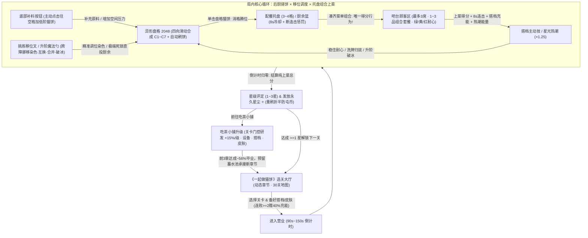

# 一起做猫饼 (`v0.8.0` 重构基线 → `v0.9.0` 精修版) — 改版总览与演进方案

> **版本定位与命名归正**：
> - 游戏尚未正式公测上线，全套文档版本号统一按上线前 SemVer 规范归正为：**`v0.1.0 ~ v0.4.0`**（早期物理玻璃罐合成原型，已归档至 `docs/archive/`）→ **`v0.8.0`**（完成「异形盘格 2048 滑动合成 × 配餐托盘组合上菜 × 3 章 30 关」核心重构的代码基线）→ **`v0.9.0`**（当前目标：内测经济平衡、挑拣移位叉重塑与厨余篮冷却精修版）→ **`v1.0.0`**（微信小游戏正式首发版）。
> - 最新 `v0.9.0` 专项增量变更详见 **[./v0.9.0-版本调整计划书.md](./v0.9.0-版本调整计划书.md)**。

---

## 1. 核心体验与重构演进动机

### 1.1 一句话核心体验
**「异形盘格四向 2048 搓猫饼」×「点击补料紧迫压盘」×「单击装入配餐托盘组合上菜」×「挑拣移位叉空间调度」×「《飞机大厨》式实时客流冲星闯关」**

### 1.2 从 `v0.4.x` 物理罐到 `v0.8.0 / v0.9.0` 的两大跨越
1. **`v0.4.x → v0.8.0` 核心玩法彻底重构**：
   - **确立全局唯一计分铁律**：原版合成、破冰、撞弹柱全在加分，“上菜”沦为附带行为；重构后确立**只有把组合好的猫饼端给顾客（上菜），才能获得分数！** 合成只负责造出高阶原料，绝不直接产生 1 分。
   - **移动端直觉操控与碎片化节奏**：放弃随机弹跳的玻璃罐发射器与冗长 5 幕肉鸽，转向 **四向滑动 2048 合成 + 点击补料按钮 + 单击装盘上菜**，单局收敛至 `90~150 秒`；全品类重绘为极具记忆点的 **7 阶纯猫造型「猫饼（Cat-Cake）」**，聚焦 **3 大章节 × 30 关主线地图**。
2. **`v0.8.0 → v0.9.0` 内测经济与厨具机制精修**：
   - **收敛货币与乘区泡沫，预留长线新章节空间**：收紧初始星尘（`15 ⭐`）、单级研发增幅（`+15%/级`）与叠乘峰值，新增同星重刷收益折半衰减；前 3 章 30 关满星产出约 `~3,150 ⭐`（占全店 `5,650 ⭐` 的 **`~56%`**），留足 `~2,500 ⭐` 高阶养成蓄水池承接 `v1.1.0+` 第 4~5 章与新玩法。
   - **根治“免费无限丢弃架空叉子”的设计重叠**：为厨余篮加入 **`8.0s` 冷却 + 断连击 + 扣减 `15` 热潮能量**，同时将鸡肋清格叉重塑为 **「挑拣移位叉」**（支持跨障挪移染色、异阶互换、同阶跨格合并破邻冰、单点破冰、以及直投厨余无视冷却救急），恢复异形 2048 的空间博弈张力并保持 100% 零死锁。

---

## 2. 全面改动与演进对照表

| 改动维度 | 早期 `v0.4.x` 原型（已淘汰） | `v0.8.0` 重构基线（现行代码） | **`v0.9.0` 精修目标态（待代码落地）** |
| :--- | :--- | :--- | :--- |
| **游戏名称** | 《星夜吃茶：喵呜甜品合合乐》 | **《一起做猫饼》** | **《一起做猫饼》**（`GAME_VERSION = '0.9.0'`） |
| **底层核心玩法** | 玻璃罐 2D 刚体物理弹射合成（`physics.js`） | 异形盘格 2048 四向滑动 + 揉面补料（`grid_engine.js`） | 保持异形 2048 底座，强化盘面空间稀缺性 |
| **得分唯一来源** | 合成、破冰、技能等 10 余处加分 | **纯上菜唯一得分**（非上菜动作一律 `0` 分） | **严格保持纯上菜唯一得分**；收敛 7 层乘区叠乘泡沫 |
| **配餐托盘与厨余篮** | 无托盘（2 张订单按钮直接消球） | `3~4` 格托盘；双击托盘 0 成本无限秒丢厨余篮 | 双击/右滑丢弃触发 **`8.0s` 厨余冷却 + 断连击 + `-15` 热潮能量** |
| **应急厨具设计** | 摇罐 + 清格叉 + 升阶勺 | 泡泡清格叉（`15⭐`，仅单格消除/破冰）+ 升阶魔法勺（`20⭐`） | **🍴 挑拣移位叉（`20⭐`：挪移染色/互换/跨格合并/破冰/直投厨余）** + **✨ 升阶魔法勺（`25⭐`）** |
| **局外经济与小铺** | 4 项旧全局天赋 + 角色 + 罐子皮肤 | 7 阶猫饼研发（`+20%/级`）+ 4 设备 + 搭档 + 烤盘皮肤（总计 `5,220⭐`） | 研发改为 **`+15%/级` 且按 `unlockLevel` 关卡门控**；全店动态上限 **`5,650⭐`**（前 3 章毕业约 `56%`） |
| **关卡结算与防刷** | 打烊按积分折算星尘 | 30 关首星奖 + 重复通关全额基础奖/3星奖 | 调优 30 关 `1★~3★` 梯度（`1:1.45:1.95`）；**同星纯重刷收益折半衰减**；单关连败 `>=2` 次开局赠 `40%` 充能保底 |
| **云同步与扩展底座** | 三模式最高分 + 物理断点快照 | `schemaVersion: 2` 无损迁移 + 总星/累计分双榜 | 动态派生总星数与小铺上限、高版本 `schemaVersion` 防覆盖写保护、`modeOverrides` 模式解耦桩位 |

---

## 3. `v0.9.0` 核心循环架构图

---

## 4. 全套设计文档导航

| 序号 | 文档名称 | 核心职责与目标读者 | 关键交付内容 |
| :-: | :--- | :--- | :--- |
| **NEW** | **[v0.9.0-版本调整计划书.md](./v0.9.0-版本调整计划书.md)** | 制作人 / 策划 / 前后端研发 | **`v0.9.0` 版本号规范、经济重平衡、30关新目标分、挑拣移位叉、厨余冷却与架构加固总案** |
| **00** | **[00-核心玩法重构与演进总览.md](./00-核心玩法重构与演进总览.md)**（本文） | 制作人 / 全团队对齐 | `v0.4.x → v0.8.0 → v0.9.0` 演进对照、核心循环与研发里程碑 |
| **01** | **[01-核心玩法与系统策划案.md](./01-核心玩法与系统策划案.md)** | 策划 / 客户端主程 | 7 阶猫饼与风味规则、异形 2048、补料、托盘与 `8s` 厨余冷却、挑拣移位叉、唯一得分公式、搭档与小铺 |
| **02** | **[02-数值平衡与30关异形盘格配置表.md](./02-数值平衡与30关异形盘格配置表.md)** | 数值策划 / 关卡策划 | `v0.9.0` 猫饼(`+15%/级`)与设备升级表、24 道菜谱库、**3 章 30 关异形矩阵与新 1~3 星目标分**、长线星尘收支表 |
| **03** | **[03-UI布局与交互原型规格书.md](./03-UI布局与交互原型规格书.md)** | UI / 交互 / 前端开发 | 多视口线框图、选关地图、手势与移位叉双步仲裁状态机、厨余冷却 UI、新手引导与自适应弹窗 |
| **04** | **[04-美术与音频素材制作规范.md](./04-美术与音频素材制作规范.md)** | 美术 / 音效 / 资源管线 | 7 阶猫饼双态设定、8 位动物顾客人设、拼版 AI 生图 Prompt、包体预算与 Web Audio 表 |
| **05** | **[05-技术架构重构与代码改造方案.md](./05-技术架构重构与代码改造方案.md)** | 小游戏前端 / 云开发后端 | 源码模块矩阵、异形 2048 / 挑拣移位叉 / 托盘匹配算法、Schema v2 迁移与高版本写保护、`kissa_sync` 双榜 |
| **06** | **[06-测试与端到端验收规格书.md](./06-测试与端到端验收规格书.md)** | QA / 自动化测试 | 纯逻辑单测、客户端↔云函数同构断言、纯上菜得分铁律、`verify_minigame_e2e.mjs` 验收与 `v1.0.0` 上线清单 |

> **历史归档说明**：早期物理玻璃罐探索阶段的原型文档已统一归档至 [`docs/archive/`](./archive/)（[`v0.3.0-早期玻璃罐三模式原型规格书.md`](./archive/v0.3.0-早期玻璃罐三模式原型规格书.md) 与 [`v0.4.0-早期5幕弹珠炉原型策划案.md`](./archive/v0.4.0-早期5幕弹珠炉原型策划案.md)），一切现行与后续开发均以 `docs/` 主目录为准。

---

## 5. 分阶段研发里程碑与演进门禁

### M1 ~ M4 · `v0.8.0` 核心玩法重构基线（已完成）
- 已完成 14 张猫饼双态 PNG、顾客与棋盘特殊格图集生产及旧物理代码清理（主包约 `2.1 MB < 4 MB`）；
- 已完成 `grid_engine.js`、`order_service.js`、`levels_data.js`、`board_renderer.js`、30 关地图大厅、4 页签小铺、`schemaVersion: 2` 云同步双榜及 220 条 4-Tier E2E 回归套件落地。

### M5 · `v0.9.0` 内测经济平衡与厨具机制精修（当前阶段：文档已定稿，待代码实施）
- **交付范围**：依据 [./v0.9.0-版本调整计划书.md](./v0.9.0-版本调整计划书.md) 同步落地 `5,650 ⭐` 经济与 30 关新星级线、`8.0s` 厨余篮冷却惩罚、`applyForkAction` 挑拣移位叉 5 模式状态机、研发 `unlockLevel` 门控、连败软保底、动态星数/小铺上限派生及高版本云存档写保护。
- **门禁标准**：客户端与云函数常量表 100% 自动同构校验通过，`test_v2_core.mjs` 与 `verify_minigame_e2e.mjs` 全绿通过。

### M6 · `v0.9.x → v1.0.0` 微信小游戏正式提审首发
- **交付范围**：iOS / Android 真机手感与首日关卡留存微调、隐私保护指引核验、锁定 `GAME_VERSION = '1.0.0'` 正式发布上线；后续按 `v1.1.0+` 迭代第 4~5 章新分店与每日公平挑战玩法。
