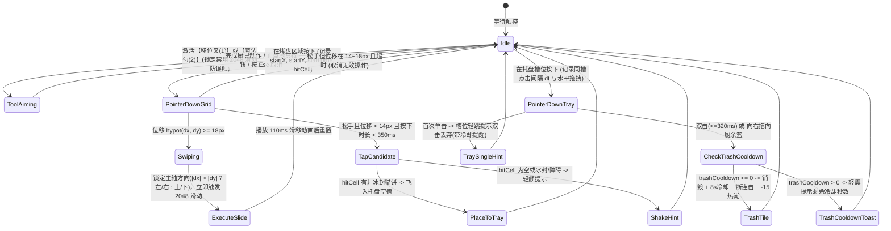

# 一起做猫饼 `v0.9.0` — UI 布局与交互原型规格书

> **文档定位与版本状态**：本文档定义 **`v0.9.0`（内测经济重构与厨具机制精修版）**的全屏布局规范、大厅选关地图、局内 4 段式竖屏线框原型、手势冲突与挑拣移位叉双阶段仲裁状态机、厨余篮冷却 UI、微动效时序、新手引导及自适应滚动弹窗规格，指导 `src/screens_ui.js`、`src/modals_ui.js`、`src/board_renderer.js` 与 `src/game_app.js` 的研发与演进（详见 [./v0.9.0-版本调整计划书.md](./v0.9.0-版本调整计划书.md)）。

---

## 1. 多分辨率与微信胶囊安全适配原则

### 1.1 目标视口矩阵
沿用 `src/platform.js` 提供的 `getSystemMetrics()`（包含 `width`, `height`, `safeTop`, `safeBottom`, `menuRect`），主舞台强制要求 **零垂直滚动、一屏展示完整**，弹窗列表支持超限自适应内部裁剪滚动：

| 设备档位 | 分辨率基线 | 核心适配重点 |
| :--- | :---: | :--- |
| **紧凑竖屏（iPhone SE）** | `375 × 667` | 极紧凑高度预算：顾客区缩至 `102px`、托盘区 `54px`、底部 Dock `64px`，保证 `5×5` 异形烤盘仍具备 `>= 46px` 单格触控面积 |
| **主流全面屏（iPhone 14/15）** | `390 × 844` | 顶部严格避让微信右上角胶囊 `menuRect`（左边界 `maxRight = menuRect.left - 8`），底部严格预留 `safeBottom`（约 `20~34px`） |
| **宽屏桌面预览 / 开发者工具** | `1280 × 760` | 居中三栏布局（左栏顾客/订单详情、中栏核心托盘+异形烤盘+补料、右栏搭档立绘与快捷统计），两侧留出暖木屋背景氛围 |

### 1.2 微信胶囊与安全区铁律
1. **顶部第一行导航栏**：所有按钮右侧边界不得超过 `menuRect.left - 8px`；`topY = menuRect ? menuRect.top : Math.max(8, safeTop + 4)`，与胶囊高度齐平（`32~34px`）。
2. **底部操作 Dock**：必须位于 `height - Math.max(10, safeBottom + 8)` 之上，防止 iOS Home Indicator 误触导致退出小游戏。
3. **无文字溢出与零原生 Emoji 铁律**：沿用 `src/ui_draw.js` 的 `UI.drawFitText`，任何数字/标签均带最小字号兜底与自动测宽缩放，Canvas 文本严禁渲染彩色原生 Emoji 字符（统一使用手绘图标图集，仅允许 BMP 几何符号如 `★ ☆ ✓ ×`）。

---

## 2. 大厅与章节选关地图原型（Lobby & Map）

采用直观的**《飞机大厨》式章节选关大厅**，章节列表与总星数分母动态读取 `CHAPTERS.length` 与 `MAX_CAMPAIGN_STARS`（当前 3 章共 `90` 星，后续 `v1.1.0+` 新增第 4~5 章时无需改 UI 硬编码）：

### 2.1 竖屏大厅线框图（`390 × 844`）
```text
+-------------------------------------------------------+
| [⭐15]   [猫饼名片/已云存]   [乐][音][?]   [微信胶囊] | <- 顶部胶囊安全栏 (34px)
+-------------------------------------------------------+
|       ╭───────────────────────────────────────╮       |
|       │    一 起 做 猫 饼  ·  第1章 街角星夜店  │       | <- 招牌木牌(ui_title_plaque) +
|       │      <  切换营业分店  >       ★ 24/90 │       |    动态章节切换横幅 (64px)
|       ╰───────────────────────────────────────╯       |
|                                                       |
|      (1-4 ★★☆) ───── (1-5 ★★★) ───── (1-6 ★★☆)        |
|          │                             │              |
|      (1-3 ★★★)                       (1-7 ★☆☆)        | <- 蜿蜒手绘烤盘路径地图
|          │                             │              |    (占中庭 ~55% 高度)
|      (1-2 ★★★) ───── (1-1 ★★★)       (1-8 [锁])       |
|                                        │              |
|                      (1-10 [锁]) ─── (1-9 [锁])       |
+-------------------------------------------------------+
|  [小蜜柑立绘]  "今天也来做香香猫饼吧!"  [切换搭档 v]  | <- 吧台搭档看板条 (76px)
+-------------------------------------------------------+
|  ┌─────────────────────────────────────────────────┐  |
|  │       ★ 开始营业 · 第 1-7 关 (目标 ★1)          │  | <- 主 CTA 按钮 (48px)
|  └─────────────────────────────────────────────────┘  |
|  [ 小铺(红点) ]  [ 图鉴 ]  [ 排行 ]  [ 主题 ]         | <- 底部 4 格功能 Dock (44px)
+-------------------------------------------------------+
```

### 2.2 章节地图交互细节
- **品牌招牌木牌（`ui_title_plaque`）**：主标题展示 **「一 起 做 猫 饼」**，下方副标题展示当前章节名称与累计星数（`totalStars / MAX_CAMPAIGN_STARS`）。
- **关卡节点状态**：
  - **已解锁/已通关**：显示关卡号与底部 3 颗星状态（实心金星/空心描边星），点击弹出**「关前整备简卡」**。
  - **当前推进关**：外圈跳动金光脉冲圈，点击底栏主 CTA 直接进入。
  - **未解锁章节/关卡**：灰色木纹锁头图标，点击飘字提示解锁条件（如“需通关 1-10 且累计总星 >= 18 ★”）。
- **小铺红点精准门控**：仅当玩家当前 `bankStardust` 买得起某项升级、**且该项已满足 `unlockLevel` 解锁关卡条件**时，才在大厅小铺按钮右上角点亮提示红点。

---

## 3. 局内 4 段式竖屏布局原型（Gameplay Screen · `v0.9.0`）

### 3.1 竖屏局内线框图与高度分配（`390 × 844`）
```text
+-------------------------------------------------------+
| [||] [1-5]  01:28   ★ 1,850 / 2,700 [▓▓▓░░]   [胶囊]  | <- 1. 顶栏安全区 (36px)
+-------------------------------------------------------+
|  ┌─────────────┐  ┌─────────────┐  ┌─────────────┐   |
|  │ [布偶猫]    │  │ [焦糖狐!]   │  │ [橘猫大叔]  │   |
|  │  C2  C3     │  │  C4         │  │  C2  C3  C4 │   | <- 2. 吧台顾客区 (112px)
|  │  ✓   □     │  │  □   ×1.25  │  │  ✓   ✓   □  │   |
|  │ ████████░░  │  │ ████░░░░░░  │  │ ██████████  │   |
|  └─────────────┘  └─────────────┘  └─────────────┘   |
+-------------------------------------------------------+
|  配餐托盘:  [ C2 ]  [ C3 ]  [ 空 ]  [ 空 ]  [厨余 8s] | <- 3. 配餐托盘带 (60px)
|  3连上菜 ×1.13 (8s) |  星光热潮 64% [▓▓▓▓▓░░░]        |
+-------------------------------------------------------+
|                                                       |
|             ┌───┬───┬───┬───┐                         |
|             │C2 │   │   │C1 │   ← '#' 处留空透出木盘  |
|             ├───┼───┼───┼───┤                         |
|             │C3 │ X │C4*│   │   ← 可上菜猫饼亮金呼吸圈 | <- 4. 异形猫饼烤盘区
|             ├───┼───┼───┼───┤     (自适应居中占满剩余   |
|             │C1 │C2 │C3m│   │      全部高度 ~430px)    |
|             └───┴───┴───┴───┘                         |
|                                                       |
+-------------------------------------------------------+
|  [移位叉×1]   ┌─────────────────┐   [魔法勺×1] [92%]  | <- 5. 底部操作 Dock (76px)
|   (应急20⭐)  │    揉面补料     │    (应急25⭐)       |    (含底部 safeBottom)
|               └─────────────────┘                     |
+-------------------------------------------------------+
```

### 3.2 各区块精准视觉与交互规格
1. **顶栏与星级动态进度条**：
   - 分数进度条内嵌 3 个星标刻度线，随纯上菜得分实时增长；每跨越 `star1`、`star2`、`star3` 时绽放金光粒子并触发 `playStarUnlock()` 音效。
   - **连败暖心保底开局反馈**：当该关触发 `levelFailStreaks >= 2` 软保底时，开局右下角技能环直接充至 `40%` 并浮现小蜜柑暖心提示气泡：“店长加油！已为你备好 40% 猫薄荷茶能量~”。
2. **吧台顾客区（3 席位）**：
   - 展示动物头像、所需 1~3 个猫饼小图标（含抹茶叶/草莓角标）、托盘已备齐对勾 `✓` 及底部绿(`>60%`)/黄(`25%~60%`)/红(`<25%`)三色耐心条。
   - 点击任意顾客卡切换蓝色「优先目标」锁框。
3. **配餐托盘带与厨余篮冷却 UI（`v0.9.0` 重点更新）**：
   - 居中渲染 `3` 格（或升级后 `4` 格）圆角木质餐盘槽。
   - 最右侧放置**「厨余篮」**（`tray_trash_btn`）：
     - **就绪态（`trashCooldown <= 0`）**：正常暖棕藤编篮图标；
     - **冷却态（`trashCooldown > 0`）**：叠加半透明暗色扇形遮罩与醒目倒计时文字 `冷却 Xs`（如 `8s → 1s`），期间双击或右滑托盘槽位会轻震提示“厨余篮整理中（剩余 Xs）”；
     - **移位叉救急态（`activeTool === 'fork' && forkSourceCell`）**：厨余篮外框泛起高亮琥珀虚线框，提示玩家点击此处可直接把选中的盘内猫饼无视冷却叉走销毁。
   - 托盘下方紧贴 **上菜连击徽章（`N连 ×1.XX` + `8.0s` 倒计时细条）** 与 **星光热潮条（`0~100%`，激活时显示 `热潮 ×1.25`）**。
4. **异形猫饼烤盘主舞台与移位叉双阶段高亮**：
   - 常规态下，匹配在座顾客未完成需求的非冰封猫饼泛脉冲暖金框。
   - **挑拣移位叉第 1 步（待选起点）**：全盘所有非空猫饼与冰封格泛起**青蓝色呼吸选框**，顶部轻提示“点冰块直接破冰，或点猫饼挑起挪移/互换/合并”。
   - **挑拣移位叉第 2 步（已锁定起点 `forkSourceCell`）**：起点猫饼上浮 `6px` 并套双层亮金选环；全盘所有合法落点（空白可用格、可互换异阶猫饼、可跨格合并同阶 `<C7` 猫饼）泛起**翠绿色虚线导引框**（`#`、`X` 与冰封格保持暗淡不可落位）。
5. **底部操作 Dock**：
   - 中央超大**「揉面补料」按钮**；
   - 左侧**「挑拣移位叉」**（耗尽时角标显示 **`20⭐`**，单关限应急购 1 次）、右侧**「升阶魔法勺」**（耗尽时角标显示 **`25⭐`**，单关限应急购 1 次）；
   - 最右侧**「搭档主动技」圆钮**。

### 3.3 宽屏桌面布局（`>= 820px`，`1280 × 760`）
- **左栏（`260px`）**：纵向 3 张顾客详情卡 + 本关 1~3 星目标明细。
- **中栏（弹性居中）**：配餐托盘与厨余篮 + 大型异形烤盘 + 底部补料与厨具栏。
- **右栏（`240px`）**：搭档半身立绘 + 搭档主动技大按钮 + 星光热潮仪表盘 + 快捷键提示（`WASD/方向键` 滑动、`Space` 补料、`1` 移位叉、`2` 魔法勺、`Esc` 取消厨具瞄准、`F` 放技能）。

---

## 4. 核心手势冲突与厨具瞄准仲裁状态机（`v0.9.0`）



---

## 5. 核心动效与视听反馈规范

| 触发事件 | 视觉动效与粒子 | 耗时 | 音频配合 |
| :--- | :--- | :-: | :--- |
| **四向有效滑动** | 猫饼按路径平滑插值移动至目标格；合成格由 `0.78 → 1.16 → 1.00` Q 弹缩放 + 暖金星花迸发 | `110ms` | `playGridSlide()` + `playMerge(tier)` |
| **无效滑动撞墙** | 靠边猫饼向撞击方向整体微震 `4px` 后回弹 | `90ms` | `playGridBlocked()` |
| **补料 / 自动刷饼** | 对应空格中心浮现小面团缩放 `0.2 → 1.08 → 1.0` + 白色面粉轻烟 | `130ms` | `playKneadSpawn()` |
| **挑拣移位叉挪移/互换** | 猫饼沿 `board_to_board` 抛物弧线跨障飞跃（互换时双弧线交错），落入特殊格迸发染色星尘 | `180ms` | `playTool('fork')` |
| **挑拣移位叉跨格合并** | 起点猫饼弧线飞入目标格，触发 Q 弹合成光圈与正交 4 邻接碎冰特效 | `200ms` | `playTool('fork')` + `playMerge(tier)` |
| **单击装入托盘** | 猫饼从盘格沿贝塞尔曲线飞入目标托盘槽（同步显示盘格变空） | `160ms` | `playTrayPlace()` |
| **托盘凑齐自动上菜** | 匹配槽位闪金框 → 整组猫饼齐飞向对应顾客 → 弹出 **`+XXX 分` / `Combo ×N`** | `280ms` | `playServeBell()` + `playOrderComplete()` |
| **丢进厨余篮** | 猫饼落入右侧厨余篮冒微灰烟圈，连击条熄灭，厨余篮开启 `8.0s` 冷却倒计时遮罩 | `180ms` | `playTrayTrash()` |
| **破冰成功** | 相邻合成或移位叉单点瞬间，蓝白冰晶向四周爆散碎裂，露出底层高阶猫饼 | `220ms` | `playIceShatter()` |
| **顾客耐心归零离开** | 头像转灰冒小乌云滑出退场；连击徽章闪灰清零 | `260ms` | `playCustomerAngry()` |
| **得分突破 1/2/3 星** | 顶栏对应星星图标放大 `1.45×` 亮金闪耀 | `300ms` | `playStarUnlock(starIdx)` |

---

## 6. 分步新手引导脚本（`v0.9.0` 文案校准）

采用 `src/modals_ui.js` 中的**半透明聚光灯（Spotlight）非阻塞式气泡**：

| 触发时机 | 高亮区域 | `v0.9.0` 引导文案 | 完成条件 |
| :--- | :--- | :--- | :--- |
| **1-1 开局第 1 步** | 烤盘中 `(0,0)` 与 `(0,1)` 两颗 `C1` | 「向左或向右滑动，把两颗小面团合成为 **焦糖猫爪曲奇**！」 | 执行 1 次有效合成滑动 |
| **1-1 第 2 步** | 底部「揉面补料」按钮 | 「急缺原料时，点击【揉面补料】随时往盘里加 1 颗小猫饼！」 | 点击 1 次补料按钮 |
| **1-1 第 3 步** | 盘内亮金圈的 `C2` 与顶部托盘 | 「单击亮金圈的猫饼装进**配餐托盘**，凑齐订单就自动上菜得分啦！」 | 完成首单上菜并看到加分 |
| **1-3 首次错放/多品** | 配餐托盘与右侧「厨余篮」 | 「放错猫饼可**双击丢进厨余篮**腾位（有 `8s` 整理冷却且会断连击，也可以善用左下【移位叉】调位哦）！」 | 出现提示横幅或首次托盘满时触发 |
| **2-1 特殊格教学** | 盘内 `M` 抹茶洒粉格 | 「带绿叶的格子会为猫饼洒上**抹茶粉**！搭配抹茶订单可享 **`×1.25`** 赏金！」 | 完成 1 次抹茶染色/合成或点击跳过 |
| **3-1 破冰教学** | 盘内 `I` 冰封格及相邻位置 | 「冰封猫饼被冻住啦！在**上下左右相邻格合成**或用**【移位叉】轻点**即可震碎冰壳！」 | 震碎首块冰封格后自动消失 |

---

## 7. 5 大核心弹窗线框与自适应滚动规格

所有弹窗统一沿用暖木框 + 羊皮纸内底风格，宽度自适应 `min(width - 24, 460px)`。**长线扩展防挤压铁律**：小铺与图鉴列表均设置最小舒适行高（小铺卡片 `minRowH = 68px`，菜谱行 `minRowH = 52px`），一旦总内容高度超出弹窗可视区高度，自动开启 `modalScrollRect / modalMaxScroll` 触摸滚轮平滑滚动，确保未来新增第 5 件设备、第 4 位搭档或第 25+ 道菜谱时永远清晰不重叠。

### 7.1 关前整备简卡（Level Preview Modal）
```text
+-----------------------------------------------+
|  [茶]  第 1-5 关 · 双凹烘焙槽            [×]  |
+-----------------------------------------------+
|  ┌─────────────┐   营业时长: 105 秒            |
|  │ .  #  #  .  │   ★1: 2,700  ★2: 3,920       |
|  │ .  .  .  .  │   ★3: 5,350                  |
|  │ .  .  .  .  │   特产: C1~C4 组合 · 含急单   |
|  │ .  #  #  .  │                              |
|  └─────────────┘   历史最佳: 4,120 (★★☆)      |
|-----------------------------------------------|
|  出战搭档: [小蜜柑 v]  主动技: 安抚猫薄荷茶    |
|-----------------------------------------------|
|         [   ★ 开始营业 (105s)   ]             |
+-----------------------------------------------+
```

### 7.2 1~3 星打烊结算弹窗（Level Result Modal）
```text
+-----------------------------------------------+
|          打烊结算 · 第 1-5 关            [×]  |
+-----------------------------------------------+
|            ★       ★       ☆                 | <- 依次缩放点亮动画
|          「营业达标 · 完美出餐!」               |
|-----------------------------------------------|
|  纯上菜总分:   4,120   (新纪录!)               |
|  已服务顾客: 11 位 | 最高连击: 4连 | VIP: 0 位 |
|-----------------------------------------------|
|  星尘收益 ⭐:  +21 ⭐                          |
|   · 首达2星奖 +15⭐ · 过关基础奖 +6⭐          |
|-----------------------------------------------|
|  [ 重玩 ]      [ 小铺 ]      [ 下一关 -> ]     |
+-----------------------------------------------+
```
- 同星纯重刷时清晰提示“重温营业奖励（首星突破奖已领）”；未达 `star1` 时提示安慰星尘与小铺研发指引（连续失败第 2 次时额外提示“下局小蜜柑将为你预充 40% 技能能量！”）。

### 7.3 新版 4 页签「吃茶小铺」（Shop Modal · 含关卡解锁门控）
```text
+-----------------------------------------------+
|  [店] 吃茶小铺             [⭐ 140]      [×]  |
+-----------------------------------------------+
|  [ 猫饼研发 ] [ 后厨设备 ] [ 搭档 ] [ 皮肤 ]   | <- 4 页签横排胶囊
+-----------------------------------------------+
|  ┌─────────────────────────────────────────┐  |
|  │ [C2图] 焦糖猫爪曲奇       Lv.1 / Lv.4   │  |
|  │        菜价: 81 -> 91 (+15%)   [⭐ 60]  │  |
|  ├─────────────────────────────────────────┤  |
|  │ [C6图] 星空猫马卡龙       Lv.0 / Lv.4   │  |
|  │        菜价: 1400 -> 1610  [2-1 解锁]   │  | <- 未达 unlockLevel 置灰门控
|  ├─────────────────────────────────────────┤  |
|  │ ... (超出视口自动启用平滑纵向滚动) ...   │  |
|  └─────────────────────────────────────────┘  |
+-----------------------------------------------+
```

### 7.4 猫饼与菜谱双页图鉴（Compendium Modal）
- 页签 1（`7阶猫饼`）：展示 `C1~C7` 造型、当前研发菜价与解锁关卡（未解锁呈剪影）。
- 页签 2（`24道菜谱`）：滚动列表展示 `R01~R24` 配方小图标、组合倍率（`×1.00 / ×1.12 / ×1.25`）与基准分。

### 7.5 双榜排行榜与店长名片弹窗（Leaderboard & Profile Modal）
- 顶部提供合规透明 `wx.createUserInfoButton` 店长名片授权卡；下方切换 **「★ 总星数进度榜」** 与 **「累计营业榜」** Top 50 列表及底部固定「我的排名」。
