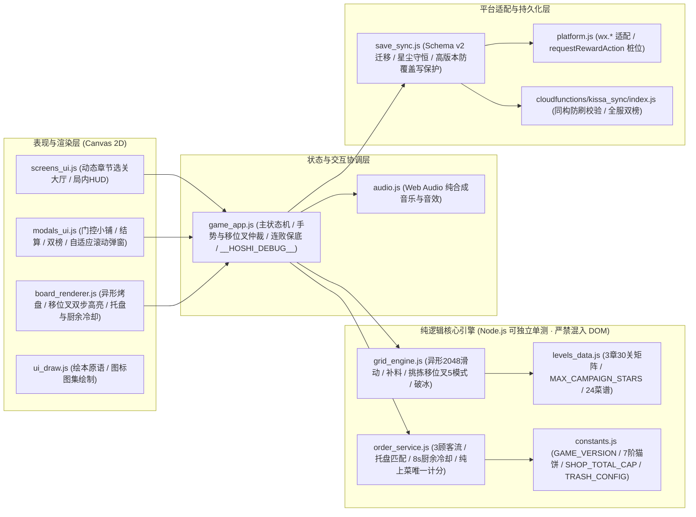

# 一起做猫饼 (`v0.8.0` 架构基线 → `v0.9.0` 演进) — 技术架构与代码改造方案

> **文档定位与版本号解耦说明**：
> - 本文档面向微信小游戏前端与云开发后端研发人员，记录 `05-微信小游戏版本/` 与 `cloudfunctions/kissa_sync/` 的分层架构、核心纯函数引擎、Schema v2 存档无损迁移以及 **`v0.9.0` 经济、厨具与长线扩展加固规范**（详见 [./v0.9.0-版本调整计划书.md](./v0.9.0-版本调整计划书.md)）。
> - **双版本号解耦原则**：对外产品版本号由 `constants.GAME_VERSION = '0.9.0'` 管理（正式首发定为 `'1.0.0'`）；而内部存档结构号保持整数 `SCHEMA_VERSION = 2`（函数名 `migrateV1ToV2`、脚本名 `test_v2_core.mjs`、资产名 `title_hero_v2.jpg` 均指代第 2 代数据结构，保持不变）。

---

## 1. 软件架构总览

工程剥离了早期重型 2D 刚体物理引擎，将核心玩法抽离为**零平台依赖、可直接在 Node.js 下独立单测的纯数据引擎**（`grid_engine.js`、`order_service.js`、`levels_data.js`），与 Canvas 2D 渲染层（`board_renderer.js`、`screens_ui.js`、`modals_ui.js`）严格解耦。



---

## 2. 源码模块职责与 `v0.9.0` 演进矩阵

### 2.1 已清理移除的历史废弃文件
- **`v0.8.0` 第一次清理**：`05-微信小游戏版本/src/{physics.js, physics_shapes.js, jar_renderer.js}`、`scripts/extract_physics_shapes.py`、`02-游戏素材-精修透明PNG/{physics_shapes.json, sprites_meta.json}` 及旧 `tier_1~9*` 素材。
- **`v0.9.0` 全量 UI 重构后二次清理**：彻底移除已整体被 `05-微信小游戏版本/assets/ui_v090/` 取代的 `02-游戏素材-精修透明PNG/`（78 文件）、`03-游戏素材-原始原图与WebP/`（17 文件）及配套旧切图脚本 `scripts/extract_assets.py`、`scripts/extract_ui_assets.py`。

### 2.2 核心业务模块清单（`05-微信小游戏版本/src/` 扁平 CommonJS）
| 文件路径 | 核心职责 | `v0.8.0` 已落地基线接口 | **`v0.9.0` 待落地增量改造要点** |
| :--- | :--- | :--- | :--- |
| `src/constants.js` | 全局目录与经济常量唯一真源 | `CATCAKES`, `FLAVORS`, `SHOP_DEVICES`, `CUSTOMERS`, `PATRONS`, `TOOLS`, `BOARD_THEMES` | 新增 `GAME_VERSION = '0.9.0'`、`DEFAULT_INITIAL_STARDUST = 15`、`TRASH_CONFIG`、动态派生 `SHOP_TOTAL_CAP = 5650`；收敛 `+15%/级` 菜价与乘区；重命名 `TOOLS.fork` 为 `'挑拣移位叉'`（`cost: 20` / `spoon: 25`） |
| `src/levels_data.js` | 关卡矩阵与菜谱数据 | `CHAPTERS`, `RECIPES`, `LEVELS` (30关), `isLevelUnlocked` | 导出动态 `MAX_CAMPAIGN_STARS`；更新章节首星/基础星尘、24 菜谱 `comboMult` 与全 30 关新 `stars` 目标分 |
| `src/grid_engine.js` | 异形盘格 2048 纯逻辑引擎（`0` 分铁律） | `createGridState`, `slideGrid`, `kneadSpawn`, `removeTileAt`, `upgradeTileAt`, `shatterAdjacentIce`, `applyLunaBoardTidy`, `applyMugiBoardBlast` | 新增快照事务保护的 **`applyForkAction(state, fromR, fromC, toR, toC, opts)`**（统一承载单点破冰、跨障挪移染色、异阶互换、同阶跨格合并破邻冰、直投厨余 5 分支） |
| `src/order_service.js` | 3 顾客波次、托盘与**唯一计分模块** | `createOrderState`, `stepCustomers`, `tryPlaceToTray`, `discardTraySlot`, `matchTrayToCustomer`, `computeServeScore`, `computeLevelSettlement` | `createOrderState` 支持第 4 参数 `modeOverrides`；`discardTraySlot` 接入 `8.0s` 冷却拦截、断连击与扣 `15` 热潮；`computeLevelSettlement` 实施同星纯重刷收益折半衰减 |
| `src/board_renderer.js` | 顾客卡、托盘带与异形烤盘渲染 | `computeBoardLayout`, `renderCustomersBar`, `renderTrayStrip`, `renderBoardStage` | 渲染厨余篮 `冷却 Xs` 遮罩、移位叉第 1/2 步双阶段选框与 `board_to_board` 抛物线飞行动画 |
| `src/game_app.js` | 主控制器、手势仲裁与 `__HOSHI_DEBUG__` | 状态机、计时结算、搭档/厨具、聚光灯引导 | 维护 `forkSourceCell` 双步交互与点厨余篮救急；校验小铺研发 `unlockLevel`；实现 `levelFailStreaks >= 2` 开局赠 `40%` 充能保底 |
| `src/screens_ui.js` & `modals_ui.js` | 大厅地图、HUD 与全套弹窗 | 3 章节地图、4 页签小铺、图鉴、双榜、预览/结算弹窗 | 动态读取 `CHAPTERS.length` 与 `MAX_CAMPAIGN_STARS`；小铺研发未达 `unlockLevel` 置灰显示 `X-X 解锁`；小铺与图鉴加入最小行高超限自动裁剪滚动 |
| `src/save_sync.js` & `platform.js` | 存档迁移、星尘守恒与平台接口 | `SCHEMA_VERSION = 2`, `migrateV1ToV2`, `computeSpentStardust`, `mergeSaveData` | 引用动态 `SHOP_TOTAL_CAP`；新增 `levelFailStreaks`；加入 **`raw.schemaVersion > SCHEMA_VERSION` 高版本防覆盖写保护**；`platform.js` 预留 `requestRewardAction(scene)` 桩位 |
| `cloudfunctions/kissa_sync/index.js` | 云端合并、反作弊与双排行榜 | `pull`, `push`, `updateProfile`, `leaderboard` (`stars` & `score`) | 同步 `v0.9.0` 价格表、`DEFAULT_INITIAL_STARDUST` 与 `MAX_CAMPAIGN_STARS`，通过单测强制校验与客户端 100% 同构 |

---

## 3. 核心数据结构与算法规范

### 3.1 `grid_engine.js` — 异形分段滑动与「挑拣移位叉」纯函数算法

#### 异形分段滑动算法（`slideGrid(state, dir)`）
1. 按 `type === 'void' || type === 'block' || (cell.tile && cell.tile.frozenHp > 0)` 为**硬墙断点**，将每行/每列拆分成多个连续可滑动的子段（Segment）。
2. 子段内非空猫饼紧缩并从前沿依次两两比较：同阶且 `< 7` 则合并为 `tier + 1`，指针 `i += 2`（**单步防连合**），记录 `mergeEvents[]`。
3. 若发生位移或合并（`moved === true`）：先对 `mergeEvents` 的正交 4 邻接格执行 `shatterAdjacentIce`（本步刚破冰的猫饼不顺带滑走），再对停驻在 `G/M/B` 格的非冰封猫饼执行 `applyCellDye`（`gold` 永不降级），最后在随机空白可用格生成 1 颗 `C1/C2`。

#### 挑拣移位叉事务函数（`applyForkAction(state, fromR, fromC, toR, toC, opts)` · `v0.9.0`）
全程使用 `captureGridSnapshot` 保护，**不生成新猫饼、严格 `0` 分变动**：
- **分支 1（单点破冰 `mode: 'shatter_ice'`）**：当未传目标坐标且 `(fromR, fromC)` 上存在 `frozenHp > 0` 猫饼时，置 `frozenHp = 0` 并触发所在格 `applyCellDye`。
- **分支 2（直投厨余救急 `mode: 'trash'`）**：当 `opts?.discardToTrash === true` 且起点为非冰封猫饼时，直接清空 `(fromR, fromC)`，供倒计时末段“盘满 + 托盘满 + 厨余篮冷却中”无损解死锁。
- **分支 3（跨障挪移染色 `mode: 'move'`）**：起点为非冰封猫饼、目标 `(toR, toC)` 为空白可用格（`.`/`G`/`M`/`B`）时，移动猫饼至目标格并触发 `applyCellDye`。
- **分支 4（同阶跨格合并 `mode: 'merge'`）**：起点与目标均为非冰封同阶猫饼且 `tier < 7` 时，在 `(toR, toC)` 合成为 `tier + 1`（调用 `resolveMergedFlavor` 继承风味与目标格染色），自动调用 `shatterAdjacentIce(state, toR, toC)` 震碎正交 4 邻冰，若 `newTier >= 5` 返回 `skillChargeGain: 8`。
- **分支 5（异阶或双 `C7` 互换 `mode: 'swap'`）**：起点与目标均为非冰封猫饼且异阶（或两颗 `C7`）时，交换两格猫饼并分别为双方执行新落点 `applyCellDye`。

### 3.2 `order_service.js` — 子集匹配、厨余冷却与唯一计分

1. **贪心多重集子集匹配（`matchCustomerWithTray`）**：
   - 先匹配订单中指定风味槽位（精确风味优先，其次万能 `gold`），再匹配 `'any'` 槽位（优先消耗 `plain` → 普通风味 → 最后才动用 `gold`）。
   - 多顾客同时满足时优先级：`preferredSeatIdx` > 最低耐心比例（差距 `>= 0.10`） > `isVip` > `isUrgent` > 最小 `seatIdx`。
2. **厨余篮冷却与惩罚（`discardTraySlot` · `v0.9.0`）**：
   - 校验 `state.trashCooldown > 1e-6` 时拦截并返回 `{ discarded: false, reason: 'cooldown', cooldownLeft }`；
   - 成功丢弃后写入 `trashCooldown = 8.0`、`comboCount = 0`、`comboTimer = 0`、`feverEnergy = Math.max(0, feverEnergy - 15)`，`score` 不变。
3. **模式参数覆盖预留（`modeOverrides` · `v0.9.0`）**：
   - `createOrderState(levelCfg, saveData, rng, modeOverrides)` 支持通过 `modeOverrides` 注入固定养成等级（如每日公平挑战赛统一 `catcakeLevels = Lv.2`、`devTrayLv = 1`），无需改动核心计分与客流引擎即可扩展新玩法模式。

### 3.3 `levels_data.js` — 关卡配置结构示例（`3-1` · `v0.9.0` 数值）
```js
{
  id: '3-1',
  chapter: 3,
  indexInChapter: 1,
  name: '草莓雪夜',
  durationSec: 120,
  stars: [18500, 26800, 36600],
  baseClearDust: 14,
  firstStarDust: [22, 30, 42],
  matrix: [
    '.....',
    '.BI..',
    '..IM.',
    '#...#'
  ],
  presets: [
    { r: 0, c: 1, tier: 3, flavor: 'plain', frozen: false },
    { r: 0, c: 2, tier: 3, flavor: 'plain', frozen: false },
    { r: 1, c: 1, tier: 2, flavor: 'berry', frozen: false },
    { r: 1, c: 2, tier: 4, flavor: 'plain', frozen: true },
    { r: 2, c: 2, tier: 4, flavor: 'plain', frozen: true },
    { r: 2, c: 4, tier: 3, flavor: 'plain', frozen: false }
  ],
  allowedRecipes: ['R15','R16','R17','R18','R19','R20','R21','R22'],
  urgentRate: 0.25,
  vipQuota: 2
}
```

---

## 4. 存档 Schema v2、星尘守恒与高版本写保护（`src/save_sync.js`）

沿用本地存储键名 `STORAGE_KEY = 'hoshi_kissa_bakery_save_v1'`，内部结构代数 `SCHEMA_VERSION = 2`。

### 4.1 存档结构（含 `v0.9.0` 扩展字段）
```jsonc
{
  "schemaVersion": 2,
  "bgmTrack": "waltz",
  "sfxEnabled": true,

  // 永久星尘银行与严格消费守恒: bankStardust = totalEarnedStardust - computeSpentStardust(save)
  "bankStardust": 15,
  "totalEarnedStardust": 15,
  "consumableSpentStardust": 0,
  "lastSyncedEarnedStardust": 15,

  // 关卡进度、高分与单关连败计数 (连败 >= 2 触发开局 +40% 技能充能保底，过关删除对应 key)
  "levelStars": {},
  "levelBestScores": {},
  "levelFailStreaks": {},
  "highestUnlockedLevel": "1-1",

  // 吃茶小铺养成项 (动态总上限 SHOP_TOTAL_CAP = 5,650)
  "catcakeLevels": { "1": 0, "2": 0, "3": 0, "4": 0, "5": 0, "6": 0, "7": 0 },
  "deviceUpgrades": { "dev_tray": 0, "dev_flour": 0, "dev_teapot": 0, "dev_tools": 0 },
  "selectedPatron": "mikan",
  "unlockedPatrons": ["mikan"],
  "equippedTheme": "amber",
  "unlockedThemes": ["amber"],

  "seenTutorials": {},
  "playerProfile": { "nickName": "", "avatarUrl": "", "avatarPreset": "mikan", "authorized": false, "updatedAt": 0 },
  "lifetimeStats": {
    "runsPlayed": 0,
    "ordersServed": 0,
    "vipServed": 0,
    "maxComboEver": 0,
    "highestSingleServe": 0,
    "totalStars": 0,
    "totalCumulativeScore": 0
  },
  "updatedAt": 0
}
```

### 4.2 老存档无损迁移与高版本防降级覆盖保护
1. **`migrateV1ToV2(raw)` 守恒兼容**：旧天赋 `shopUpgrades` 100% 退还，已解锁搭档/皮肤自动按最新定价补齐差额确保老测试档零扣减余额，并附赠 `+50 ⭐` 答谢礼。
2. **高版本云存档防覆盖铁律（`v0.9.0` 加固）**：若未来 `v1.1.0+` 升级至 `schemaVersion: 3`，而玩家在尚未热更新缓存的旧版微信客户端拉取到 `cloudDoc.schemaVersion > SCHEMA_VERSION`，客户端必须标记 `higherSchemaDetected = true`、跳过覆盖式 `push` 并友好提示重启小游戏更新最新版本，杜绝新章节或新系统存档字段被旧客户端洗白。

---

## 5. 微信云函数 `cloudfunctions/kissa_sync/index.js` 规范

1. **同构防刷与守恒审计**：
   - 服务端与客户端共享完全一致的 `CATCAKE_UPGRADE_COSTS`（`3,920`）、`DEVICE_UPGRADE_COSTS`（`1,250`）、`PATRON_COSTS`（`240`）、`THEME_COSTS`（`240`）、`SHOP_TOTAL_CAP = 5,650` 及 `MAX_CAMPAIGN_STARS`；
   - 校验单关分数上限（第 1 章 `<= 35,000`、第 2 章 `<= 90,000`、第 3 章 `<= 220,000`）与 `score > 0` 必须满足 `serves >= 1`；
   - 采用乐观锁 `revision` 合并多端增量（单次离线星尘增量上限 `MAX_OFFLINE_STARDUST_DELTA = 1500`）。
2. **双排行榜查询（`action === 'leaderboard'`）**：
   - `boardType: 'stars'`（按 `totalStars` 降序，同星按 `totalCumulativeScore` 决胜）与 `boardType: 'score'`（按 `totalCumulativeScore` 降序，兼容 `'totalScore'` 别名），返回 Top 50 与 `myRank`。
