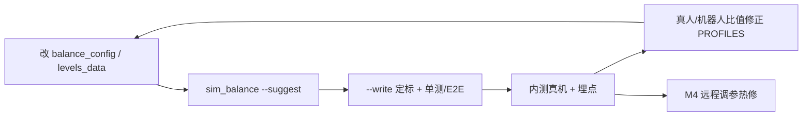

# 07 · 数值模拟与调参手册（v0.10+）

> 适用范围：`05-微信小游戏版本/src/balance_config.js`、`scripts/sim_balance.mjs`、`scripts/lib/headless_app.mjs`。
> 目的：把「拍脑袋调星级」改为「模型 + 模拟 + 埋点」三位一体的可迭代流程。

## 1. 数值单一来源 `balance_config.js`

| 表 | 作用 |
|---|---|
| `FEATURES` | 每个新系统一个开关（`scoreZones / bakeCrit / freshBonus / doughTemp / feverV2 / goals / events / traits / daily / endless`），可单独回滚或做 A/B |
| `SCORE_ZONES` | 乘区上限与各项场面加成 |
| `BAKE_CRIT` / `FRESH` / `DOUGH_TEMP` / `FEVER_V2` | M1 核心循环参数 |
| `TELEMETRY` | We分析 事件名（需先在微信后台登记） |
| `REMOTE_OVERRIDE_BOUNDS` | 远程调参白名单与上下限（M4 云函数 `config` 下发，`applyRemoteOverrides()` 夹逼生效） |

**规则：任何新增加成必须先声明归属哪个乘区，并在本表登记。**

## 2. 乘区制计分模型

$$
\text{score} = \text{round}\Big(\sum_i p_i f_i h_i \times (1+\text{clamp}(B_{skill}, -0.4, 0.9)) \times C_{cust} C_{trait} \times (1+\text{clamp}(B_{scene}, -0.5, cap))\Big)
$$

| 乘区 | 组成 | 合成方式 | 上限 |
|---|---|---|---|
| 品质区（逐件） | 售价 `p`（含 +15%/级）× 风味 `f`（金 1.35 / 指定风味 1.25）× 热乎 `h`（`C2+` 合成后 6s 内 1.15，`freshBonus`） | 逐件相乘后求和 | — |
| 技巧区 | 套餐件数（+0.12/+0.25）+ 耐心小费（+0.20/0/-0.20）+ 连击（+0.06…+0.28）+ 麦麦被动 +0.10 | 相加 | `skillCap 0.90` |
| 顾客区 | 顾客赏金倍率 × 顾客特性倍率（M3） | 相乘 | 特性 ≤ `1.60` |
| 场面区 | 热潮 +0.20（`feverV2`；关闭时为旧 +0.25）+ 蜜柑 +0.08 + 露娜一次性 +0.50 + 托盘 Lv2 三件 +0.12 + 事件/词条/规则 | 相加 | `sceneCap 1.00`（无尽可提高至 1.60） |

- 常见组合（单品 / 双拼 / 低连击、无热潮）与旧连乘公式偏差 ≤ 3%（`UT-O12`）。
- 堆满时自动压缩：旧公式理论最大约 ×4.3，新公式约 ×3.3（顾客区另计）。
- 旧公式保留在 `FEATURES.scoreZones = false` 后可回退，`UT-O06` 同时校验两套结果。

## 3. 数值模拟器 `scripts/sim_balance.mjs`

- **真实控制器**：用 `headless_app.mjs` 在 Node 里无头启动 `game_app`，开启 `setHeadlessSim(true)` 跳过渲染。机器人通过 `__HOSHI_DEBUG__` 操作（滑动、揉面、点格、上菜、技能、丢弃），所以 M1~M3 的新系统改完就会自动进入模拟。
- **可复现**：每局 `seed` 固定，网格、顾客、事件三条随机流分开（`rng.js`）。
- **模式隔离**：`modeOverrides.mode = 'sim'` 时不写存档、不推云、不触发连败保底。
- **按章假设的局外养成**（`META_BY_CHAPTER`）：

| 章 | 价格等级 | 设备 |
|---|---|---|
| 1 | 全 0 | 全 0 |
| 2 | C1~C5 Lv1 | 托盘 1 / 面粉 1 / 厨具 1 |
| 3 | C1~C5 Lv2、C6 Lv1 | 托盘 2 / 面粉 2 / 茶壶 1 / 厨具 1 |

- **真实揉面**：机器人调用 `dbg.knead({ realistic: true })`，与玩家按钮走同一条面团温度/过热锁/热潮揉面路径（默认的 `dbg.knead()` 仍是绕过温度的原始补料，供 E2E 精确断言）。熟练/高手的揉面节奏间隔 `0.38s / 0.42s`，正好落在金色温区。
- **M1 资源系统**（烘焙暴击、热乎、热潮 V2 连锁/延时/余温）全部由控制器自动结算，模拟器无需特判；暴击与合成仍 0 分，只通过更多热潮与更高阶饼间接抬高上菜分。

### 3.1 三档机器人

| 档位 | 每秒操作数 | 噪声 | 特征 |
|---|---|---|---|
| 新手 | 0.88 | 0.45 | 贪心但常选错方向，随机忽略部分装盘机会，不太会用技能 |
| 熟练 | 1.32 | 0.22 | 按订单缺口给合成打分，优先拿热乎饼，揉面有节奏（0.44s 适温），会放技能 |
| 高手 | 1.95 | 0 | 在熟练的基础上向前看 1 步，零失误追热乎与适温保底 |

> [!NOTE]
> 机器人信息完美、没有反应延迟，所以绝对水平比真人高。**机器人分布只用来定相对难度曲线**，绝对档位要用内测埋点（`runReport.telemetry`、We分析 `level_end`）回填校准：按真人 P50 与机器人 P50 的比值修正 `PROFILES.aps / noise`。

### 3.2 定标规则（`--suggest` / `--write`）

1. **新手期平滑系数（`ONBOARDING_RAMP`）**：前 3 关教学期乘以缓冲系数（`1-1: 0.55×`、`1-2: 0.72×`、`1-3: 0.86×`，`1-4+` 为 `1.00×`），抵消首玩阅读引导与手势熟悉耗时。
2. 1★ ≈ 新手 P50 × ramp。
3. 2★ ≈ 熟练 P50 × ramp，且 ≥ 1★ × 1.30。
4. 3★ ≈ 熟练 P85 × ramp，并且不超过 max(高手 P60 × ramp, 2★ × 1.15)。
5. 比例约束：2★ / 1★ 在 1.32~1.65，3★ / 1★ 在 1.72~2.30。
6. 全局单调与反作弊裕度：全 30 关 1★ 严格递增（对齐 `T2-F02-04`），且 `3★ × 2.5 ≤ maxScoreAntiCheatCap`（对齐 `L2-6`）。
7. 取整：1000 以下按 10，1 万以下按 50，其余按 100。

### 3.3 CI 门禁（`--check`）

满足以下任一条件就判失败：
- 1★ < 新手 P20 × ramp × 0.85（太容易）；
- 1★ > 熟练 P50（太难）；
- 3★ > 高手 P90 × 1.1（打不到）；
- 有任何一局启动失败。

### 3.4 常用命令

```bash
node scripts/sim_balance.mjs --seeds 16 --md /tmp/sim.md          # 全量报告（2 核约 11 分钟）
node scripts/sim_balance.mjs --levels 1-1,1-2 --seeds 30           # 只跑指定关卡
node scripts/sim_balance.mjs --seeds 16 --write                    # 把建议星级写回 levels_data.js
node scripts/sim_balance.mjs --check --seeds 6 --profiles novice,skilled,expert
```

## 4. 埋点

| 通道 | 内容 |
|---|---|
| `runReport.telemetry`（云函数 push 携带） | 模式、种子、数值版本、滑动、合成、揉面、暴击 2/3/4、热乎上菜、狂欢次数、过热、愤怒离店、目标达成、事件数 |
| We分析 `level_start` | `level_id / mode / fail_streak / patron` |
| We分析 `level_end` | 上述字段 + `score / stars / serves / cleared` |

`platform.reportEvent` 会把键转成蛇形命名并只保留数值和字符串。在浏览器或开发环境里，事件记到内存日志，供 `dbg.getReportedEvents()` 断言。

## 5. 调参闭环


