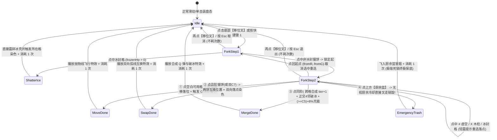

# 《一起做猫饼》v0.9.0 版本调整计划书（内测经济重构与厨具机制精修版）

> **文档状态**：`v0.9.0` 策划与架构定稿（当前阶段仅输出与同步全套设计文档，暂未修改源码；代码落地以本计划书为唯一执行依据）
> **适用工程**：`05-微信小游戏版本/`（客户端） & `05-微信小游戏版本/cloudfunctions/kissa_sync/`（云函数）

---

## 一、版本号体系归正说明：为什么定为 `v0.9.0`

由于《一起做猫饼》尚未在微信小游戏平台正式公测上线，此前内部文档混用的 `v1`、`2.0`、`2.x`、`3.0`、`4.0`、`4.1` 违背了语义化版本规范（SemVer 2.0.0）与小游戏提审发布惯例，且出现了“旧原型叫 `4.0/4.1`、新重构反而叫 `2.0`”的倒挂混乱。自本轮起，全项目统一归正为 **`0.x.y`（上线前研发序列）→ `v1.0.0`（正式首发版）** 标准体系：

| 研发阶段 | 标准产品版本号 | 对应历史文档标识 | 阶段定义与核心里程碑 |
| :--- | :---: | :---: | :--- |
| **早期原型探索期** | `v0.1.0 ~ v0.4.0` | 原误标 `v1 / 2.x / 3.0 / 4.0 / 4.1` | 早期 2D 物理玻璃罐合成、3 模式与 5 幕弹珠炉原型（已归档淘汰） |
| **核心重构基线（现行代码）** | **`v0.8.0`** | 现行 `docs/00..06` 基线 | 完成异形盘格 2048 烘焙 + 3 席实时出餐 + 3 章 30 关战役 + 双榜云同步骨架 |
| **本次调整目标版本** | **`v0.9.0`** | **本文档定义** | **内测经济平衡与厨具机制精修版（Beta Overhaul）**：收紧货币与得分膨胀、重塑挑拣移位叉、增加厨余篮冷却及长线扩展加固 |
| **准上线打磨期** | `v0.9.1 ~ v0.9.x` | — | 真机兼容性、新手引导转化率与单关通过率微调（Release Candidate） |
| **微信正式首发版** | **`v1.0.0`** | — | **首次面向公众提审上线版本**（锁定首发经济与存档基线） |
| **上线后长线迭代** | `v1.1.0 / v1.2.0+` | — | 新增第 4~5 章新机关关卡、每日公平挑战赛、分包主题皮肤与商业化变现模块 |

### 版本号与代码内部标识符解耦约定
1. **对外产品版本号与文档目录规范**：统一在 `src/constants.js` 新增导出 `GAME_VERSION = '0.9.0'`（上线前 CI 上传版本号同步规范为 `0.9.<run_number>`，正式首发切换为 `1.0.0`）；全部现行策划与技术文档统一直接置于 `docs/` 主目录下（不绑死旧版本号目录名），早期物理罐原型归档于 `docs/archive/`。由于游戏尚未正式上线，无需背负复杂的线上旧物价差额历史包袱，可直接确立最干净的 `v0.9.0` 经济基准。
2. **源码/资源内部代数标识**：现行代码与资产引用中的 `SCHEMA_VERSION = 2`（`schemaVersion: 2`、`migrateV1ToV2`）、测试脚本 `scripts/test_v2_core.mjs` 以及素材名 `title_hero_v2.jpg` / `--v2` 参数代表“第 2 代核心玩法数据/资源结构”（因本阶段不改代码暂维持现状，如需更名可在代码实施阶段连同引用一并调整）。

---

## 二、现存痛点诊断与核心设计决策

### 2.1 现行 `v0.8.0` 基线的四大问题
1. **局外星尘与局内营业分双重膨胀**：
   - 新号开局赠送 `30 ⭐`，`1-1` 未打即可直接进小铺升 `C1 Lv.1`；`1-1` 满星单局入账高达 `83 ⭐`，重复刷已满星关卡仍全额发放过关奖与 `3★` 额外奖；
   - 局内 7 层乘区叠乘（菜价 `1.80×` × 镀金 `1.50×` × 3品 `1.35×` × 绿条 `1.30×` × 5连 `1.50×` × VIP `1.50×` × 热潮 `1.35×`）最高放大至 **`14.35×`**，导致中后期轻易爆分碾压三星线。
2. **叉子道具定位鸡肋，与免费厨余丢弃高度重叠**：
   - 现行 `泡泡清格叉` 仅能消除单格猫饼（或第 3 章破冰）；但在前两章非冰封关卡中，玩家随时可“单击猫饼进托盘 + 双击托盘免费丢入厨余篮”实现 **0 成本无限消格洗盘**，导致叉子毫无存在感，且免费无限洗盘彻底架空了异形 2048 的空间管理博弈。
3. **长线章节扩展的经济透支隐患**：
   - 若在前 3 章 30 关就投放过多星尘让玩家把小铺买穿，未来 `v1.1.0+` 更新第 4、5 章与新玩法时，老玩家将出现严重货币溢出与养成真空。
4. **后期迭代硬编码耦合**：
   - 大厅 `/90` 总星数、章节数 `1..3`、小铺固定行高、小铺总花费上限 `5220`、客户端与云函数重复常量表以及旧客户端覆盖高版本云存档等潜在隐患需在上线前一次性解耦加固。

### 2.2 `v0.9.0` 四大核心设计定案
1. **长线经济留白（前 3 章达成 `~56%` 毕业度，全店毕业需后续章节或深度挑战）**：
   - 全小铺满级总容量定为 **`5,650 ⭐`**（动态派生导出 `SHOP_TOTAL_CAP`）。
   - 玩家打穿前 3 章全部 **30 关**并拿满 **90 星**（含正常冲星重试）自然累计产出约 **`~3,150 ⭐`**——恰好足够解锁全部主厨搭档、成型全套后厨设备并将主力猫饼升至 `Lv.2 ~ Lv.3` 流畅通关第 3 章；
   - 剩余约 **`~2,500 ⭐`（主要集中在 `C4~C7` 的 `Lv.3 → Lv.4` 顶配研发）** 作为长线养成蓄水池，无缝承接 `v1.1.0+` 第 4~5 章及新玩法产出（在当前仅 30 关阶段，全收集硬核玩家若追求 100% 满级，需在通关 30 关后额外重刷约 `95~105` 局高阶 VIP 关，全流程约 `135~145` 局）。
2. **厨余篮「8s 冷却 + 浪费惩罚」**：
   - 保留双击/右滑托盘丢入厨余篮的操作直觉，但每次丢弃后厨余篮进入 **`8.0s` 整理冷却**，同时**立即中断上菜连击（`comboCount = 0`）并扣减 `15%` 星光热潮能量**（已有营业总分绝不扣减），彻底封堵“无脑装盘秒扔洗盘”漏洞。
3. **重塑叉子为「挑拣移位叉」+ 极端残局零死锁闭环**：
   - 将叉子从鸡肋“消除器”升级为高上限空间调度神器——支持 **①跨障挪移并触发落点染色**、**②异阶（或双 `C7`）位置互换**、**③同阶（`< C7`）跨格合并破邻冰**、**④单点冰封格一键破冰**，以及 **⑤选中猫饼后点【厨余篮】无视冷却直接销毁**，确保在任何极端残局下 100% 零死锁。
4. **轻度玩家连败软保底（DDA）**：
   - 同一关卡连续未达 1 星失败 **`>= 2` 次**时，下一局开局店长小蜜柑自动赠送 **`40%` 初始搭档技能充能**（一旦该关通关即刻清零重置），温和托底休闲玩家卡关挫败感，同时不影响高手首通与排行榜公平性。

---

## 三、分模块详细调整规格

### 模块 1：经济收支重平衡与研发渐进门控（`src/constants.js`）

#### 1.1 版本与初始货币常量
- `GAME_VERSION = '0.9.0'`
- `DEFAULT_INITIAL_STARDUST = 15`（原 `30`；新档开局无法直接购买最低 `25 ⭐` 的升级，必须先体验并通关 `1-1`）

#### 1.2 局内上菜得分乘区收敛表
保留“**纯上菜唯一得分**”核心铁律，全面收敛各乘区峰值以消除指数级分数泡沫：

| 乘区维度 | 涉及常量 / 函数 | `v0.8.0` 基线值 | **`v0.9.0` 调整值** | 调整目的 |
| :--- | :--- | :--- | :--- | :--- |
| 猫饼研发单级增幅 | `getCatcakePrice` | `+20% / 级`（满级 `1.80×`） | **`+15% / 级`（满级 `1.60×`）** | 防止满级研发直接数值碾压后续新章节星级线 |
| 风味与镀金倍率 | `FLAVORS` | 抹茶/草莓 `1.35×`，镀金 `1.50×` | **抹茶/草莓 `1.25×`，镀金 `1.35×`** | 保留风味溢价与镀金万能匹配地位，抑制单品爆分 |
| 套餐组合倍率 | `COMBO_SIZE_MULTS` | `{ 1: 1.00, 2: 1.18, 3: 1.35 }` | **`{ 1: 1.00, 2: 1.12, 3: 1.25 }`** | 平滑多品套餐加价幅度 |
| 耐心三段小费 | `PATIENCE_TIP_BANDS` | 绿(`>0.55`) `1.30×`，红(`<0.25`) `0.85×` | **绿(`>0.60`) `1.20×`，红(`<0.25`) `0.80×`** | 绿条要求更敏捷出餐，红条拖延惩罚更清晰 |
| 上菜连击窗口与倍率 | `SERVE_COMBO_WINDOW_SEC` & `SERVE_COMBO_MULTS` | `10.0s` 窗，`[1.00, 1.10, 1.22, 1.35, 1.50]` | **`8.0s` 窗，`[1.00, 1.06, 1.13, 1.20, 1.28]`** | 缩短续连窗口至 `8s` 并压低 5 连封顶上限 |
| 星光热潮充能与倍率 | `FEVER_CONFIG` | 充能 `20/25/35`，得分 `1.35×` | **充能 `16/20/30`，得分 `1.25×`** | 由 4 单满槽延至 5~6 单满槽，热潮爆发更稀缺珍贵 |
| VIP 美食家星尘红包 | `cust_critic.rewardDustBonus` | `5 ⭐` | **`4 ⭐`** | 控制多 VIP 关卡单局星尘产出 |

#### 1.3 吃茶小铺 `v0.9.0` 完整定价表（动态导出 `SHOP_TOTAL_CAP = 5,650`）
- **猫饼研发渐进解锁门控**：启用 `CATCAKES` 中的 `unlockLevel` 字段校验——未到达对应解锁关卡前（如未解锁 `3-1` 时看 `C7`），小铺研发按钮置灰显示 `3-1 解锁`，防止新手误屯币越级投资盘面根本不会出现的猫饼。

| 分类 | ID / 名称 | 解锁门控 | Lv.0~Lv.4 菜价 (`+15%/级`) / 等级效果 | 各级花费 (⭐) | 单项小计 | 分类合计 |
| :--- | :--- | :---: | :--- | :---: | :---: | :---: |
| **猫饼研发** | `C1` 奶团小猫饼 | `1-1` | `30 / 35 / 39 / 44 / 48` | `25 / 50 / 80 / 120` | `275` | **`3,920`** *(原 3,670)* |
| **猫饼研发** | `C2` 焦糖猫爪曲奇 | `1-1` | `70 / 81 / 91 / 102 / 112` | `30 / 60 / 95 / 145` | `330` | 〃 |
| **猫饼研发** | `C3` 抹茶猫耳团子 | `1-1` | `150 / 173 / 195 / 218 / 240` | `40 / 75 / 115 / 175` | `405` | 〃 |
| **猫饼研发** | `C4` 蜂蜜猫猫布丁 | `1-3` | `320 / 368 / 416 / 464 / 512` | `50 / 95 / 145 / 215` | `505` | 〃 |
| **猫饼研发** | `C5` 草莓猫咪大福 | `1-6` | `680 / 782 / 884 / 986 / 1088` | `65 / 120 / 185 / 270` | `640` | 〃 |
| **猫饼研发** | `C6` 星空猫马卡龙 | `2-1` | `1400 / 1610 / 1820 / 2030 / 2240` | `85 / 150 / 235 / 340` | `810` | 〃 |
| **猫饼研发** | `C7` 星冠猫神蛋糕 | `3-1` | `2800 / 3220 / 3640 / 4060 / 4480` | `105 / 185 / 280 / 385` | `955` | 〃 |
| **后厨设备** | `dev_tray` 宽大木托盘 | 默认开放 | `3格 → 4格 → 4格+3品小费12%` | `75 / 165` | `240` | **`1,250`** *(原 1,150)* |
| **后厨设备** | `dev_flour` 精选猫饼粉 | 默认开放 | `C2 率: 10% → 18% → 26% → 35%` | `55 / 110 / 180` | `345` | 〃 |
| **后厨设备** | `dev_teapot` 暖心红茶壶 | 默认开放 | `耐心: +0% → +12% → +24% → +38%` | `60 / 115 / 190` | `365` | 〃 |
| **后厨设备** | `dev_tools` 备货厨具架 | 默认开放 | `叉1勺0 → 叉1勺1 → 叉2勺1 → 叉2勺2` | `50 / 95 / 155` | `300` | 〃 |
| **主厨搭档** | `luna` 星兔 / `mugi` 柴柴 | 默认开放 | 主动技 + 常驻被动（`mikan` 免费） | `100` / `140` | `240` | **`240`** *(原 200)* |
| **烤盘皮肤** | `sakura` 樱花 / `moonlight` 月光 | 默认开放 | 程序化主题烤盘与氛围粒子（`amber` 免费） | `100` / `140` | `240` | **`240`** *(原 200)* |

- **局内应急厨具单关限购价调整**：`TOOLS.fork.cost = 20 ⭐`（原 `15`），`TOOLS.spoon.cost = 25 ⭐`（原 `20`），每关各限应急购买 `1` 次。

---

### 模块 2：30 关星级门槛与章节星尘收支重调（`src/levels_data.js`）

#### 2.1 章节星尘奖励调整（重一次性首星突破、轻重复刷关）
| 章节 | 解锁条件 | 首星突破奖 `firstStarDust` `[1★, 2★, 3★]` | 单关满星首奖小计 | 10 关首星合计 | 过关基础奖 `baseClearDust` |
| :--- | :--- | :---: | :---: | :---: | :---: |
| **第 1 章《街角星夜店》** | 默认开启 | **`[10, 15, 22]`** *(原 15/20/30)* | `47 ⭐` | `470 ⭐` | **`6 ⭐`** *(原 10)* |
| **第 2 章《樱花露台店》** | 通关 `1-10` 且 `>= 18★` | **`[16, 22, 32]`** *(原 20/25/35)* | `70 ⭐` | `700 ⭐` | **`10 ⭐`** *(原 14)* |
| **第 3 章《月光天台店》** | 通关 `2-10` 且 `>= 40★` | **`[22, 30, 42]`** *(原 25/35/45)* | `94 ⭐` | `940 ⭐` | **`14 ⭐`** *(原 18)* |

- 导出动态计算的 `MAX_CAMPAIGN_STARS = LEVELS.length * 3`，彻底消除 UI 与校验层的 `/90` 硬编码。
- 同步更新 `RECIPE_LIST`（`R01~R24`）的 `comboMult`（`1.00 / 1.12 / 1.25`）与新风味倍率（`1.25×`）对应的 `baseScoreLv0`。

#### 2.2 全 30 关 `stars: [1★, 2★, 3★]` 目标分校准表
将 `1★ : 2★ : 3★` 跨度由原 `1.00 : 1.38 : 1.75` 拉宽至 **`1.00 : 1.45 : 1.95`**，保证 `1★` 通关顺畅、`3★` 必须依靠小铺研发升级 + 敏捷绿条连击 + 合理使用厨具与搭档技能方可摘得：

| 关卡 | `v0.8.0` 原目标分 | **`v0.9.0` 新目标分 `[1★, 2★, 3★]`** | 关卡 | `v0.8.0` 原目标分 | **`v0.9.0` 新目标分 `[1★, 2★, 3★]`** |
| :-: | :---: | :---: | :-: | :---: | :---: |
| `1-1` | `750 / 1050 / 1400` | **`850 / 1250 / 1750`** | `2-6` | `10600 / 14600 / 18600` | **`11900 / 17300 / 23600`** |
| `1-2` | `1100 / 1520 / 1950` | **`1250 / 1820 / 2500`** | `2-7` | `11600 / 16000 / 20300` | **`13000 / 18900 / 25800`** |
| `1-3` | `1650 / 2280 / 2900` | **`1850 / 2700 / 3700`** | `2-8` | `12800 / 17650 / 22500` | **`14400 / 20900 / 28600`** |
| `1-4` | `2000 / 2750 / 3500` | **`2250 / 3280 / 4450`** | `2-9` | `13800 / 19000 / 24200` | **`15500 / 22500 / 30800`** |
| `1-5` | `2400 / 3300 / 4200` | **`2700 / 3920 / 5350`** | `2-10` | `15000 / 20700 / 26400` | **`16800 / 24400 / 33500`** |
| `1-6` | `2900 / 4000 / 5100` | **`3250 / 4750 / 6450`** | `3-1` | `16500 / 22800 / 29000` | **`18500 / 26800 / 36600`** |
| `1-7` | `3500 / 4850 / 6150` | **`3950 / 5750 / 7800`** | `3-2` | `18200 / 25100 / 32000` | **`20400 / 29600 / 40400`** |
| `1-8` | `3800 / 5250 / 6650` | **`4300 / 6250 / 8450`** | `3-3` | `20000 / 27600 / 35200` | **`22400 / 32500 / 44400`** |
| `1-9` | `4200 / 5800 / 7350` | **`4750 / 6900 / 9350`** | `3-4` | `21800 / 30100 / 38400` | **`24400 / 35400 / 48400`** |
| `1-10` | `4800 / 6600 / 8400` | **`5400 / 7850 / 10600`** | `3-5` | `23800 / 32850 / 41900` | **`26700 / 38700 / 52800`** |
| `2-1` | `5800 / 8000 / 10200` | **`6500 / 9450 / 12900`** | `3-6` | `25800 / 35600 / 45400` | **`28900 / 41900 / 57200`** |
| `2-2` | `6600 / 9100 / 11600` | **`7400 / 10750 / 14700`** | `3-7` | `28000 / 38600 / 49200` | **`31400 / 45500 / 62000`** |
| `2-3` | `7500 / 10350 / 13200` | **`8400 / 12200 / 16700`** | `3-8` | `30200 / 41700 / 53200` | **`33800 / 49000 / 66800`** |
| `2-4` | `8400 / 11600 / 14800` | **`9400 / 13650 / 18700`** | `3-9` | `32500 / 44850 / 57200` | **`36400 / 52800 / 72000`** |
| `2-5` | `9500 / 13100 / 16700` | **`10650 / 15450 / 21100`** | `3-10` | `35000 / 48300 / 61600` | **`39200 / 56800 / 77500`** |

> **云函数反作弊安全余量校验**：第 1 章关底 `3★ = 10,600 < 35,000`、第 2 章关底 `3★ = 33,500 < 90,000`、第 3 章关底 `3★ = 77,500 < 220,000`，均安全处在服务端单关反作弊上限之内。

---

### 模块 3：厨余篮「8s 冷却 + 浪费惩罚」与结算防屯币衰减（`src/order_service.js`）

#### 3.1 `TRASH_CONFIG` 与厨余篮冷却机制
- 在 `constants.js` 定义导出：`TRASH_CONFIG = { cooldownSec: 8.0, feverPenalty: 15, resetCombo: true }`。
- `createOrderState(levelCfgOrId, saveData, rng, modeOverrides)`：
  - 状态对象新增 `trashCooldown: 0`、`trashDiscards: 0`；
  - 新增可选第 4 参数 `modeOverrides`（允许未来每日挑战/限时活动模式覆盖固定 `catcakeLevels`、`devTrayLv`、`devTeapotLv` 等养成参数，与主线永久存档完全解耦）。
- `stepCustomers`：每帧推进递减 `state.trashCooldown = Math.max(0, state.trashCooldown - safeDt)`。
- `discardTraySlot(state, slotIdx, opts)`：
  - 当 `state.trashCooldown > 1e-6`（且非单元测试脚手架显式传入 `{ ignoreCooldown: true }`）时，拒绝丢弃并返回 `{ discarded: false, tile: null, reason: 'cooldown', cooldownLeft: state.trashCooldown }`，UI 轻震提示剩余冷却秒数；
  - 成功丢弃后：设置 `state.trashCooldown = 8.0`、`state.trashDiscards += 1`，**立即清零上菜连击（`comboCount = 0, comboTimer = 0`）**，**扣减星光热潮能量 `feverEnergy = Math.max(0, feverEnergy - 15)`**（已在热潮激活中则不中断当前热潮），**已有 `score` 严格保持不变**。

#### 3.2 结算重刷防屯币衰减（`computeLevelSettlement`）
区分“首次过关/补星突破”与“已达星级纯重刷”，彻底杜绝在低级关无脑刷钱：

| 结算情形 | 过关基础奖 `clearDustAward` | 满 3★ 额外奖 `threeStarBonusDust` | VIP 红包 `vipDustAward` | 未过关安慰奖 `consolationDust` | 典型收益举例 |
| :--- | :---: | :---: | :---: | :---: | :--- |
| **首次通关或突破新星（`newStarsDelta > 0`）** | `baseClearDust`（`6 / 10 / 14`） | `starsEarned === 3 ? 4 : 0` | `vipServed × 4` | `0` | 首通 `1-1` 三星：`47 + 6 + 4 = 57 ⭐` |
| **同星级纯重刷（`cleared && newStarsDelta === 0`）** | `ceil(baseClearDust × 0.5)`（`3 / 5 / 7`） | `starsEarned === 3 ? 2 : 0` | `vipServed × 3` | `0` | 重刷 `1-1` 三星仅 `5 ⭐`；重刷 `3-10` 满 5 VIP 得 `24 ⭐` |
| **未达 1★ 失败（且 `ordersServed >= 1`）** | `0` | `0` | `vipServed × 1` | `max(1, floor((score / star1) × 4))` | 差一点过关得 `3~4 ⭐`（`0` 单挂机严格 `0 ⭐`） |

---

### 模块 4：重塑「挑拣移位叉」与极端残局零死锁闭环（`src/grid_engine.js`）

将 `TOOLS.fork` 由鸡肋的“泡泡清格叉”重塑为战术核心道具 **「挑拣移位叉」**（简称 `移位叉`，复用 `assets/tool_fork.png` 图标，**全程严格 `0` 分变动**）：

#### `applyForkAction(state, fromR, fromC, toR, toC, opts)` 纯函数契约
- 采用 `captureGridSnapshot` / `rollbackGridSnapshot` 事务保护，非法操作 100% 无副作用回滚，且绝不触发自动刷饼（避免添乱挤占盘格）：
  1. **`mode: 'shatter_ice'`**：`toR === undefined` 且起点 `tile.frozenHp > 0` → `frozenHp = 0` 并执行 `applyCellDye`；
  2. **`mode: 'trash'`**：`opts && opts.discardToTrash === true` 且起点为非冰封猫饼 → 直接移除该猫饼腾出烤盘空格（不触发厨余篮冷却、不断连击，专供“盘满 + 托盘满 + 厨余篮冷却中”的倒计时末段救急）；
  3. **`mode: 'move'`**：起点非冰封猫饼、目标为空白可用格（`.`/`G`/`M`/`B`） → 跨过任意 `#`/`X`/`I` 移至目标格并触发 `applyCellDye`（1 步精准人工上色抹茶/草莓/镀金！）；
  4. **`mode: 'merge'`**：起点与目标均为非冰封同阶猫饼且 `tier < 7` → 在目标格合成为 `tier + 1`，按 `resolveMergedFlavor` 继承风味与目标格染色，自动调用 `shatterAdjacentIce(state, toR, toC)` 震碎正交 4 邻接冰封格，若 `newTier >= 5` 返还 `skillChargeGain = 8`；
  5. **`mode: 'swap'`**：起点与目标均为非冰封猫饼且异阶（或两颗满阶 `C7`） → 互换两格猫饼并分别为双方应用新落点染色（解救卡在死角的半成品）。

---

### 模块 5：控制器、自适应 UI、连败软保底与长线架构加固

1. **高版本云存档防覆盖保护（`src/save_sync.js` & `cloudfunctions/kissa_sync/index.js`）**：
   - 当本地或云端拉取到 `raw.schemaVersion > SCHEMA_VERSION`（例如未来 `v1.1.0` 升级了 `schemaVersion: 3` 后用户在旧缓存设备打开）时，标记 `higherSchemaDetected = true`，拦截旧客户端向云端 `push` 覆盖，防止新字段被旧版清洗丢失。
   - 新增存档字段 `levelFailStreaks: {}` 记录单关连续未通关次数（过关即删除该键）。
   - 客户端 `save_sync.js` 直接引用 `constants.js` 导出的动态 `SHOP_TOTAL_CAP`，消除多处硬编码价格表。
2. **UI 与交互同步升级（`src/game_app.js` / `board_renderer.js` / `screens_ui.js` / `modals_ui.js`）**：
   - **移位叉双阶段视觉引导**：第 1 步全盘可操作猫饼与冰块泛青蓝呼吸框；第 2 步锁定起点猫饼微浮放大 + 全盘合法落点泛翠绿虚线框 + 上方厨余篮亮起“点此可直接叉走销毁”角标提示。
   - **厨余篮冷却环与倒计时**：`trashCooldown > 0` 时厨余篮呈半透明灰态并显示 `冷却 Xs` 倒计时遮罩。
   - **小铺与图鉴自适应滚动兜底**：为列表项设置最小舒适行高（如小铺卡片 `>= 68px`），当未来新增第 5 件设备、第 4 位搭档或第 25+ 道菜谱超出视口高度时，自动启用 `modalScrollRect / modalMaxScroll` 平滑裁剪滚动。
   - **大厅动态章节与总星数**：全部改为读取 `CHAPTERS.length` 与 `MAX_CAMPAIGN_STARS`。
   - **连败暖心软保底**：`startLevelInternal` 检测到 `levelFailStreaks[levelId] >= 2` 时，开局自动赋予 `skillEnergy = Math.max(skillEnergy, 40)` 并弹出小蜜柑鼓励气泡。
   - **激励/分享扩展桩位**：在 `platform.js` 预留统一异步接口 `requestRewardAction(scene)`（开发期默认走分享回调，后续商业化一键切微信激励视频广告 `wx.createRewardedVideoAd`），并在结算上报中预留 `trashDiscards`、`forkUses`、`spoonUses` 遥测字段。
3. **测试与调试契约兼容扩展（`__HOSHI_DEBUG__`）**：
   - `version` 更新为 `'0.9.0'`；`getState()` 新增暴露 `forkSourceCell` 与 `trashCooldown`；
   - `useToolOnCell('fork', r1, c1, r2, c2)` 同时兼容单点冰块（3 参数）、单步移位/互换/合并（5 参数）与两步连点调用。

---

## 四、代码阶段实施与自动化验收清单（待开启代码修改指令后执行）

1. **静态与同构校验**：
   - 全量 JS/MJS 语法检查（`node --check`）；
   - 在 `scripts/test_v2_core.mjs` 新增 **客户端 `constants.js` / `levels_data.js` 与云函数 `kissa_sync/index.js` 价格及阈值表 100% 同构断言**。
2. **核心逻辑单测与 E2E 全量回归**：
   - 覆盖纯上菜唯一得分铁律（含挑拣移位叉全部 5 个分支 `score === 0` 断言）；
   - 覆盖厨余篮 `8.0s` 冷却拦截、断连击与热潮能量扣减；
   - 覆盖同星重刷星尘衰减、小铺研发 `unlockLevel` 门控、连败 2 次开局 `+40%` 充能保底及高版本 `schemaVersion` 防覆盖保护；
   - 通过 `node scripts/test_v2_core.mjs` 与 `node scripts/verify_minigame_e2e.mjs` 全部 4-Tier 端到端测试。
