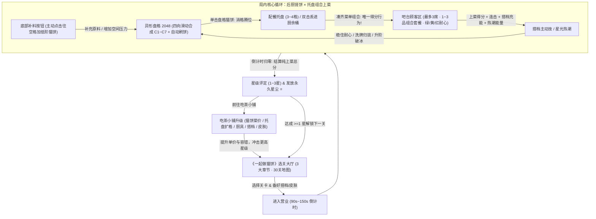

# 一起做猫饼 2.0 — 改版总览与修改方案

> **版本定位**：本文档为 **《一起做猫饼》**（原《星夜吃茶（Hoshi Kissa: Starlight Patisserie）》升级至 2.0）核心玩法大改版的最高总纲，指导从现行 v4.1「玻璃罐物理合成 × 3 模式」全面转向 **「异形盘格 2048 滑动合成 × 配餐托盘组合上菜 × 《飞机大厨》式多客流闯关」**。
> **当前阶段**：全套策划、数值、UI、美术、技术与测试验收文档定稿（本文档群位于 `docs/v2.0/`，现行 `05-微信小游戏版本/` 代码与历史文档暂不修改）。

---

## 1. 2.0 核心体验与改版动机

### 1.1 一句话核心体验
**「异形盘格四向 2048 搓猫饼」×「点击补料紧迫压盘」×「单击装入配餐托盘组合上菜」×「《飞机大厨》式实时客流冲星闯关」**

### 1.2 为什么要重构为 2.0
1. **得分目标感模糊（v4.1 痛点）**：原版合成、破冰、撞弹柱、消低阶、上菜全都在加分，玩家只需盲目合大球就能刷分，“上菜”在部分局内沦为附带行为。2.0 确立**全局唯一铁律：只有把组合好的猫饼端给顾客（上菜），才能获得分数！** 合成只负责造出高阶原料，不直接产生 1 分。
2. **物理发射上手门槛与长局疲劳**：顶部固定发射器弹壁受限于物理随机弹跳，精准度难控且 5 幕 Roguelike 单局偏长。改为移动端最直观的 **四向滑动 2048 合成 + 点击补料按钮 + 单击消格装盘**，单局时长收敛至 `90~150 秒`，碎片化爽感大幅增强。
3. **模式分散与视觉统一性**：砍掉同质化且分散精力的「90 秒狂欢模式」与「悠闲经典模式」，所有玩法收敛到**3 大章节 × 30 关主线关卡地图**；同时将所有甜点统一重塑为极具记忆点的 **7 阶纯猫造型「猫饼（Cat-Cake）」**，全面契合《一起做猫饼》的全新品牌定位与记忆点。

---

## 2. 2.0 vs 现行 v4.1 全面改动对照表

| 改动维度 | 现行 v4.1 版本（基线） | 2.0 改版方案（目标态） | 变更性质 |
| :--- | :--- | :--- | :--- |
| **游戏名称** | 《星夜吃茶：喵呜甜品合合乐》 | **《一起做猫饼》**（全新品牌主名与招牌展示） | **品牌焕新** |
| **底层核心玩法** | 玻璃罐 2D 复合凸多边形物理弹射合成（`physics.js`） | **异形盘格 2048 上下左右滑动合成 + 点击补料按钮**（`grid_engine.js`） | **彻底重构** |
| **得分唯一来源** | 合成、破冰、弹柱、技能、上菜等 10 余处均调用 `addScore` | **纯上菜唯一得分**（合成/补料/破冰/装盘/丢弃/技能一律 `0` 分） | **铁律重置** |
| **甜点品类造型** | 1~9 阶常规甜品混合（蓝莓、泡芙、柠檬塔等） | **1~7 阶纯猫造型「猫饼」（`C1~C7`）** + 中后期风味/镀金特殊格 | **全量重绘** |
| **上菜与菜单机制** | 2 张订单（快餐/VIP），长按/点按钮自动找底消球 | **3~4 格「配餐托盘」+ 最多 3 位顾客**：单击盘格猫饼消格装盘，凑齐 1~3 品组合套餐自动/一键端上，双击托盘错误猫饼丢入厨余桶 | **交互重构** |
| **新原料生成方式** | 顶部发射器按步数手动发球 | **每次有效滑动自动随机刷 1 颗低阶猫饼 + 底部「揉面补料」按钮随时主动往空格补 1 颗低阶猫饼** | **双轨生料** |
| **模式矩阵** | 3 模式：星夜主厨（5 幕肉鸽）、90 秒狂欢（`rush`）、悠闲经典（`zen`） | **移除 90 秒狂欢与悠闲经典**，聚焦单一主线：**《飞机大厨》式 3 大章节 × 10 关 = 30 关（1~3 星评定）** | **模式精简** |
| **关卡内障碍与变化** | 焦糖星环、黄油弹柱、木隔板、捣蛋毛线球、18 张秘方 | **逐关定制异形缺角轮廓 `#`** + 木质障碍柱 `X` + 镀金格 `G` + 抹茶格 `M` + 草莓格 `B` + 冰封格 `I` | **盘格演进** |
| **局内失败与容错** | 玻璃罐溢线 3.2s 判负 / 步数耗尽结算 | **营业倒计时结束结算总上菜分**；顾客耐心归零生气离店（断连击、少一单，不秒死）；盘满可借托盘/厨余桶/厨具自救 | **轻惩罚制** |
| **主厨搭档与厨具** | 3 位角色（小蜜柑/眠眠星兔/蜂蜜柴柴）各自局内主动技 + 摇罐/升阶勺 | **保留 3 位角色 PNG**，重做为适配 2048 与耐心的**上菜充能主动技 + 被动**；保留**升阶魔法勺**与**泡泡清格叉**（去掉摇罐） | **复用改造** |
| **局外养成（吃茶小铺）** | 4 项全局便利天赋（`up_tools`/`up_fever`/`up_combo`/`up_dust`）+ 角色 + 玻璃罐皮肤 | **7 阶猫饼菜价升级（Lv.0~Lv.4）** + **4 项后厨设备**（宽大木托盘 3→4 格、精选猫饼粉、暖心红茶壶、备货厨具架）+ 搭档 + 3 套**烤盘与吧台主题皮肤** | **深度扩充** |
| **美术资产与包体** | 65 文件约 `2.36 MB`（含 27 张 `tier_1~9` 序列） | 清理旧 27 张甜品与毛线球/摇罐，新增 14 张猫饼、8 位动物顾客拼版、特殊格图标拼版，主包预计 **`~2.10 MB`（远小于 4 MB 上限）** | **减重提质** |
| **云同步与排行榜** | `kissa_sync` 存三模式最高分 + 断点续玩快照 | 升级 `schemaVersion: 2` 无损退还旧天赋星尘；云榜改为 **「总星数进度榜（最高 90 星）」** + **「星夜累计营业榜」** | **平滑迁移** |

---

## 3. 2.0 核心循环架构图

---

## 4. 全套 2.0 设计文档导航

本修改方案由以下 **7 份配套文档** 组成，覆盖策划、数值、交互、美术、架构与测试全链路：

| 序号 | 文档名称 | 核心职责与目标读者 | 关键交付内容 |
| :-: | :--- | :--- | :--- |
| **00** | **[00-2.0改版总览与修改方案.md](./00-2.0改版总览与修改方案.md)**（本文） | 制作人 / 全团队对齐 | 改版全量增删改对照、核心循环、文档索引、4 阶段里程碑 |
| **01** | **[01-核心玩法与系统策划案.md](./01-核心玩法与系统策划案.md)** | 策划 / 客户端主程 | 7 阶猫饼与风味规则、异形 2048 规则、补料、托盘匹配、顾客流、唯一得分公式、搭档与小铺 |
| **02** | **[02-数值平衡与30关异形盘格配置表.md](./02-数值平衡与30关异形盘格配置表.md)** | 数值策划 / 关卡策划 | 猫饼与设备升级数值、20+ 菜谱组合库、**3 章 30 关逐关 ASCII 异形盘格矩阵与 1~3 星目标分**、星尘收支 |
| **03** | **[03-UI布局与交互原型规格书.md](./03-UI布局与交互原型规格书.md)** | UI / 交互 / 前端开发 | 竖屏（375×667 / 390×844）与宽屏线框图、选关地图、手势冲突仲裁阈值、动效表、新手引导 |
| **04** | **[04-美术与音频素材制作规范.md](./04-美术与音频素材制作规范.md)** | 美术 / 音效 / 资源管线 | 7 阶猫饼双态设定、8 位动物顾客人设、4 张拼版 AI 生图 Prompt、包体预算与 Web Audio 表 |
| **05** | **[05-技术架构重构与代码改造方案.md](./05-技术架构重构与代码改造方案.md)** | 小游戏前端 / 云开发后端 | `05-微信小游戏版本` 逐文件改造矩阵、异形 2048 与托盘匹配算法、v1→v2 存档迁移、`kissa_sync` 改造 |
| **06** | **[06-测试与端到端验收规格书.md](./06-测试与端到端验收规格书.md)** | QA / 自动化测试 | 纯逻辑单测清单、纯上菜得分断言、`verify_minigame_e2e.mjs` 重写用例、30 关数据校验脚本、上线清单 |

> **历史文档说明**：根目录下的 `游戏设计与玩法说明书.md`（3.0）与 `游戏设计案_4.0核心玩法重构.md`（4.0）均按用户要求保留作为历史版本归档参考，2.0 开发一切以此 `docs/v2.0/` 目录下的 7 份文档为准。

---

## 5. 分阶段研发里程碑与验收门禁

### M1 · 美术资产生产与数据基建（预计周期：阶段 1）
- **交付内容**：
  1. 依据 [04-美术与音频素材制作规范.md](./04-美术与音频素材制作规范.md) 生成 4 张拼版合图并接入 `scripts/extract_assets.py`，产出 14 张猫饼透明 PNG、8 位顾客拼版 `customers_atlas.png`、特殊格图标拼版 `board_tiles_atlas.png`；
  2. 清理旧 `tier_1~9`、毛线球、摇罐素材以及 `physics.js` / `physics_shapes.js` / `jar_renderer.js`；
  3. 编写 `src/constants.js`（猫饼、设备、搭档、顾客、皮肤数据）与 `src/levels_data.js`（完整 30 关异形矩阵与星级分）。
- **门禁标准**：自动化脚本校验 30 关矩阵连通性与开局坐标 100% 合法，主包体积 `< 2.4 MB`。

### M2 · 纯逻辑引擎与局内核心可玩闭环（预计周期：阶段 2）
- **交付内容**：
  1. 实现 `src/grid_engine.js`（异形盘格 2048 四向滑动、补料刷饼、风味继承、邻接破冰、死盘判定）；
  2. 实现 `src/order_service.js`（3 顾客流、配餐托盘子集匹配、双击厨余、连击/热潮、**纯上菜唯一得分**）；
  3. 实现 `src/board_renderer.js` 与 `src/audio.js` 新增音效，完成单关 `1-1` 至 `3-10` 局内完整试玩。
- **门禁标准**：Node.js 单元测试全部通过，验证“不经上菜绝不加 1 分”。

### M3 · 30 关选关大厅、吃茶小铺与完整外围系统（预计周期：阶段 3）
- **交付内容**：
  1. 重构 `src/screens_ui.js` 与 `src/modals_ui.js`：去除了旧版 3 模式卡，上线 3 大章节选关路径地图（显示 1~3 星与总星进度）；
  2. 上线新版吃茶小铺（猫饼菜价升级、4 项后厨设备、3 位搭档解锁、3 套烤盘与吧台主题皮肤）；
  3. 落地 3 位搭档全新主动技、2 枚应急厨具（魔法勺 / 清格叉）以及前 3 关分步新手引导。
- **门禁标准**：`375×667`、`390×844`（含微信右上角胶囊模拟）与 `1280×760` 全界面零重叠、零裁切。

### M4 · 存档迁移、微信云开发重构与全量 E2E 回归（预计周期：阶段 4）
- **交付内容**：
  1. 完成 `src/save_sync.js` v1→v2 存档无缝迁移（旧小铺星尘全额退还至 `bankStardust`）；
  2. 完成 `cloudfunctions/kissa_sync/index.js` 服务端校验升级与双榜（「总星数进度榜」「星夜累计营业榜」）部署；
  3. 重写 `scripts/verify_minigame_e2e.mjs` 并跑通全链路自动化验收与 GitHub Actions CI。
- **门禁标准**：[06-测试与端到端验收规格书.md](./06-测试与端到端验收规格书.md) 所有单测、E2E 断言与真机清单 100% 通过。
