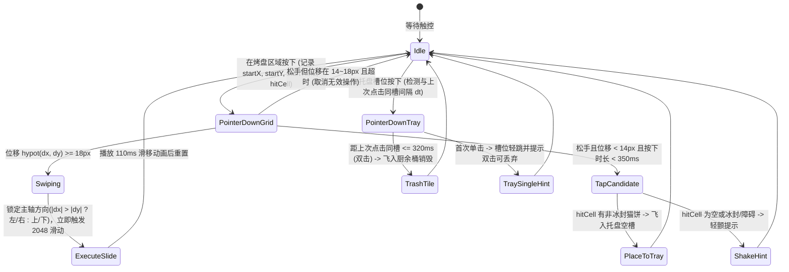

# 一起做猫饼 2.0 — UI 布局与交互原型规格书

> **文档定位**：本文档定义 2.0 版本的全屏布局规范、大厅选关地图、局内 4 段式竖屏线框原型、手势冲突仲裁状态机、微动效时序及分步新手引导，指导 `src/screens_ui.js`、`src/modals_ui.js` 与 `src/board_renderer.js` 的 Canvas 2D 排版与交互研发。

---

## 1. 多分辨率与微信胶囊安全适配原则

### 1.1 目标视口矩阵
沿用现行 `src/platform.js` 提供的 `getSystemMetrics()`（包含 `width`, `height`, `safeTop`, `safeBottom`, `menuRect`），强制要求 **零垂直滚动、一屏展示完整**：

| 设备档位 | 分辨率基线 | 核心适配重点 |
| :--- | :---: | :--- |
| **紧凑竖屏（iPhone SE）** | `375 × 667` | 极紧凑高度预算：顾客区缩至 `102px`、托盘区 `54px`、底部 Dock `64px`，保证 `5×5` 异形烤盘仍具备 `>= 48px` 单格触控面积 |
| **主流全面屏（iPhone 14/15）** | `390 × 844` | 顶部严格避让微信右上角胶囊 `menuRect`（左边界 `maxRight = menuRect.left - 8`），底部严格预留 `safeBottom`（约 `20~34px`） |
| **宽屏桌面预览 / 开发者工具** | `1280 × 760` | 居中三栏布局（左栏顾客/订单详情、中栏核心托盘+异形烤盘+补料、右栏搭档立绘与快捷统计），两侧留出暖木屋背景氛围 |

### 1.2 微信胶囊与安全区铁律
1. **顶部第一行导航栏**：所有按钮右侧边界不得超过 `menuRect.left - 8px`；`topY = menuRect ? menuRect.top : Math.max(8, safeTop + 4)`，与胶囊高度齐平（`32~34px`）。
2. **底部操作 Dock**：必须位于 `height - Math.max(10, safeBottom + 8)` 之上，防止 iOS Home Indicator 误触导致退出小游戏。
3. **无文字溢出铁律**：沿用 `src/ui_draw.js` 的 `UI.drawFitText`，任何数字/标签均带最小字号兜底与自动测宽缩放，全界面零原生 Emoji 字符（全部使用统一手绘图标图集）。

---

## 2. 大厅与章节选关地图原型（Lobby & Map）

2.0 彻底移除旧版「主厨 / 90秒狂欢 / 悠闲经典」三模式切换卡，改为直观的**《飞机大厨》式章节选关大厅**：

### 2.1 竖屏大厅线框图（`390 × 844`）
```text
+-------------------------------------------------------+
| [⭐340]  [🐾猫饼名片/云存]   [乐][音][?]   [微信胶囊] | <- 顶部胶囊安全栏 (34px)
+-------------------------------------------------------+
|       ╭───────────────────────────────────────╮       |
|       │    一 起 做 猫 饼  ·  第1章 街角星夜店  │       | <- 招牌木牌(ui_title_plaque) +
|       │      <  切换营业分店  >       ★ 24/30 │       |    章节切换横幅 (64px)
|       ╰───────────────────────────────────────╯       |
|                                                       |
|      (1-4 ★★☆) ───── (1-5 ★★★) ───── (1-6 ★★☆)        |
|          │                             │              |
|      (1-3 ★★★)                       (1-7 ★☆☆)        | <- 蜿蜒手绘烤盘路径地图
|          │                             │              |    (占中庭 ~55% 高度,
|      (1-2 ★★★) ───── (1-1 ★★★)       (1-8 🔒)         |     支持上下/左右轻滑)
|                                        │              |
|                      (1-10 🏆🔒) ─── (1-9 🔒)         |
+-------------------------------------------------------+
|  [小蜜柑立绘]  "今天也来做香香猫饼吧!"  [切换搭档 ▾]  | <- 吧台搭档看板条 (76px)
+-------------------------------------------------------+
|  ┌─────────────────────────────────────────────────┐  |
|  │       ✨ 开始营业 · 第 1-7 关 (目标 ★1)         │  | <- 主 CTA 按钮 (48px)
|  └─────────────────────────────────────────────────┘  |
|  [ 🏪 小铺(红点) ]  [ 📖 图鉴 ]  [ 🏆 排行 ]  [ ⚙ 主题 ] | <- 底部 4 格功能 Dock (44px)
+-------------------------------------------------------+
```

### 2.2 章节地图交互细节
- **品牌招牌木牌（`ui_title_plaque`）**：主标题文字由旧版「星 夜 吃 茶」正式更名为 **「一 起 做 猫 饼」**，下方副标题展示当前章节名称与累计星数（如 `第1章 · 街角星夜店`）。
- **关卡节点状态**：
  - **已通关**：显示关卡号 `1-3` 与底部 3 颗星状态（实心金星/空心描边星），点击弹出**「关前整备简卡」**（展示本关异形缩略图、1~3 星目标分、可用最高阶猫饼，并附一键开战按钮）。
  - **当前推进关**：外圈跳动金光脉冲圈 + 猫耳指针浮标，点击底栏主 CTA `✨ 开始营业` 直接秒进该关。
  - **未解锁章节/关卡**：灰色木纹锁头图标，点击飘字提示解锁条件（如“需通关 1-10 且累计总星 >= 18 ⭐”）。
- **搭档快捷条**：轻点搭档头像播放 Q 弹跳动与随机语音气泡；点右侧 `[切换搭档]` 快速在 `小蜜柑 / 眠眠星兔 / 蜂蜜柴柴` 间切换（未解锁搭档点击跳转至吃茶小铺）。

---

## 3. 局内 4 段式竖屏布局原型（Gameplay Screen）

### 3.1 竖屏局内线框图与高度分配（`390 × 844`）
```text
+-------------------------------------------------------+
| [⏸] [1-5]  ⏱ 01:28   ★ 1,850 / 2,400 [▓▓▓░░]  [胶囊]  | <- 1. 顶栏安全区 (36px)
+-------------------------------------------------------+
|  ┌─────────────┐  ┌─────────────┐  ┌─────────────┐   |
|  │ [布偶猫]    │  │ [焦糖狐⚡]   │  │ [橘猫大叔]  │   |
|  │  C2  C3     │  │  C4         │  │  C2  C3  C4 │   | <- 2. 吧台顾客区 (112px)
|  │  ✓   □     │  │  □   ×1.25  │  │  ✓   ✓   □  │   |
|  │ ████████░░  │  │ ████░░░░░░  │  │ ██████████  │   |
|  └─────────────┘  └─────────────┘  └─────────────┘   |
+-------------------------------------------------------+
|  配餐托盘:  [ C2 ]  [ C3 ]  [ 空 ]  [ 空 ]   [🗑️ 厨余] | <- 3. 配餐托盘带 (60px)
|  🔥 3连上菜 ×1.22  |  ✨ 星光热潮 65% [▓▓▓▓▓░░░]       |
+-------------------------------------------------------+
|                                                       |
|             ┌───┬───┬───┬───┐                         |
|             │C2 │   │   │C1 │   ← '#' 处留空透出木盘  |
|             ├───┼───┼───┼───┤                         |
|             │C3 │ X │C4✨│   │   ← 可上菜猫饼亮金呼吸圈 | <- 4. 异形猫饼烤盘区
|             ├───┼───┼───┼───┤     (自适应居中占满剩余   |
|             │C1 │C2 │C3🍵│   │      全部高度 ~430px)    |
|             └───┴───┴───┴───┘                         |
|                                                       |
+-------------------------------------------------------+
|  [🫧叉×1]     ┌─────────────────┐     [✨勺×1] [🌟92%] | <- 5. 底部操作 Dock (76px)
|               │  🐾 揉面补料    │                     |    (含底部 safeBottom)
|               └─────────────────┘                     |
+-------------------------------------------------------+
```

### 3.2 各区块精准视觉与交互规格
1. **顶栏与星级动态进度条**：
   - 分数进度条内嵌 3 个星标刻度线，随纯上菜得分实时增长；每跨越 `star1`、`star2`、`star3` 时对应星标弹出绽放金光粒子并触发 `playStarUnlock()` 音效。
   - **倒计时最后 15 秒**：时钟图标脉冲泛红；最后 5 秒每秒滴答提醒。
2. **吧台顾客区（3 席位）**：
   - 每张顾客卡展示：**动物头像（开心/焦急微表情）+ 所需 1~3 个猫饼小图标（含 `🍵`/`🍓` 微标）+ 对应托盘已备齐对勾 `✓` + 底部绿/黄/红三色耐心条**。
   - 若为焦糖小狐狸标注 `急单 ×1.25` 火焰角标；若为星冠美食家白猫展示皇冠金边与 `VIP ×1.5` 标识。
   - 玩家点击任意顾客卡，该卡外框亮起蓝色「🎯 优先目标」锁框。
3. **配餐托盘带**：
   - 居中渲染 `3` 格（或升级后 `4` 格）圆角木质餐盘槽，托盘槽内展示猫饼图标与风味/镀金角标。
   - 最右侧放置带有轻微摇盖动效的**「🗑️ 厨余篮」**；当盘格塞满或托盘误放时，微亮提示“双击托盘猫饼可丢弃”。
   - 托盘下方紧贴 **上菜连击徽章（`🔥 N连 ×1.XX` + 10s 倒计时细条）** 与 **星光热潮条（`✨ 0~100%`）**。
4. **异形猫饼烤盘主舞台**：
   - 根据当前关卡矩阵尺寸（`rows × cols`），按 `cellSize = floor(min((availW - 24) / cols, (availH - 20) / rows))`（上限 `88px`，下限 `46px`）居中计算每个合法格子的渲染矩形。
   - `#` 缺角完全不画格框，露出底层的温暖木纹/樱花/深海烤盘托底，直观呈现L型、十字、八角星盘的独特造型！
   - **需求高亮**：凡盘内匹配任一在座顾客未完成槽位的非冰封猫饼，格子底板泛起脉冲暖金框（若同时匹配当前已锁定的优先顾客，则显示更明亮的双层金环）。
5. **底部操作 Dock**：
   - **中央超大「🐾 揉面补料」按钮**（宽约 `152px`，高 `52px`）：点击瞬间压扁回弹，同时在烤盘随机空格“嘭”地烘烤出 1 颗低阶猫饼。
   - **左侧「🫧 清格叉」**、**右侧「✨ 升阶勺」**：显示剩余免费次数（若为 0 则显示快捷角标 `15⭐` / `20⭐`，每关限应急购买 1 次）；激活后按钮发光、烤盘外框亮起提示“请点选目标猫饼”（再点一次自身取消激活）。
   - **最右侧「🌟 搭档主动技」圆钮**：围绕搭档头像绘制环形百分比充能弧；充能 `100%` 时整枚徽章金色心跳脉冲，点击即释放。

### 3.3 宽屏桌面布局（`>= 820px`，`1280 × 760`）
- **左栏（`260px`）**：3 张顾客卡转为**纵向列表卡片**（显示更完整的菜名、风味要求与实时剩余秒数），顶部放本关 1~3 星目标明细。
- **中栏（弹性居中）**：顶部配餐托盘与厨余篮 + 中部大型异形烤盘 + 底部「揉面补料」与厨具按钮。
- **右栏（`240px`）**：当前搭档半身立绘（随上菜/热潮说话鼓励）+ 搭档主动技大按钮 + 星光热潮仪表盘 + 当前烤盘皮肤与快捷键提示（`WASD/方向键` 滑动、`Space` 补料、`1/2` 厨具、`F` 放技能）。

---

## 4. 核心手势冲突仲裁状态机

在触屏上同时支持**「四向滑动合成」**与**「单击猫饼装入托盘」**，必须依靠严格、零歧义的手势仲裁保证绝不误触：



### 4.1 仲裁关键参数（实战防误触要点）
- **移动锁定立即触发（无需等松手）**：一旦手指在烤盘内滑过 **`>= 18px`**，当即锁死为滑动手势并执行一次 2048 移动，同时标记 `gestureConsumed = true`，松手不再触发点击，连续滑多步极度跟手（支持“滑一下→略抬手→再滑”）。
- **防斜滑死区**：判断方向时若 `Math.abs(Math.abs(dx) - Math.abs(dy)) < 4px` 暂延 `2px` 直到明确主轴，避免 45 度角斜划乱跑。
- **厨具/瞄准态优先拦截**：若当前已按下 `清格叉` 或 `升阶勺`，烤盘内的任何单击优先判定为“对目标格使用厨具”（此时锁定禁用滑动，防止想点猫饼却滑乱阵型）。

---

## 5. 核心动效与视听反馈规范

| 触发事件 | 视觉动效与粒子 | 耗时 | 音频配合 |
| :--- | :--- | :-: | :--- |
| **四向有效滑动** | 猫饼按路径平滑插值移动至目标格；合成格由 `0.78 → 1.16 → 1.00` Q 弹缩放 + 暖金星花迸发 | `110ms` | `playGridSlide()` + `playMerge(tier)` |
| **无效滑动撞墙** | 所有靠边猫饼向撞击方向整体微震 `4px` 后回弹 | `90ms` | `playGridBlocked()` |
| **补料 / 自动刷饼** | 对应空格中心浮现小面团缩放 `0.2 → 1.08 → 1.0` + 白色面粉轻烟 | `130ms` | `playKneadSpawn()` |
| **单击装入托盘** | 猫饼从盘格坐标沿抛物贝塞尔曲线飞入目标托盘槽（同步显示盘格变空） | `160ms` | `playTrayPlace()` |
| **托盘凑齐自动上菜** | 匹配槽位闪金框 → 整组猫饼齐飞向对应顾客头像 → 顾客弹出大字 **`+XXX 分` / `Combo ×N`** 与爱心星光 | `280ms` | `playServeBell()` + `playOrderComplete()` |
| **双击丢进厨余桶** | 猫饼缩旋转抛物线落入右侧厨余篮，篮盖轻掀吐出微灰烟圈 | `180ms` | `playTrayTrash()` |
| **破冰成功** | 相邻格发生合成瞬间，冰封格蓝白冰晶向四周爆散碎裂，露出底层高阶猫饼 | `220ms` | `playIceShatter()` |
| **顾客耐心归零离开** | 头像转灰并冒小乌云，向屏幕侧边滑出退场；连击徽章闪灰熄灭 | `260ms` | `playCustomerAngry()` |
| **得分突破 1/2/3 星** | 顶栏对应星星图标放大 `1.45×` 亮金闪耀 + 顶部轻微光带扫过 | `300ms` | `playStarUnlock(starIdx)` |

---

## 6. 前 3 关分步新手引导脚本

采用 `src/modals_ui.js` 中的**半透明聚光灯（Spotlight）非阻塞式气泡**（复用 `collectGuideSpotlights` 模式，聚焦关键区域并放行真实操作完成引导）：

| 触发时机 | 高亮区域 | 引导文案（简短清晰） | 完成条件 |
| :--- | :--- | :--- | :--- |
| **1-1 开局第 1 步** | 烤盘中 `(0,0)` 与 `(0,1)` 两颗 `C1` | 「向左或向右滑动，把两颗小面团合成为 **焦糖猫爪曲奇**！」 | 玩家执行 1 次有效合成滑动 |
| **1-1 第 2 步** | 底部「🐾 揉面补料」按钮 | 「急缺原料时，点击【揉面补料】随时往盘里加 1 颗小猫饼！」 | 玩家点击 1 次补料按钮 |
| **1-1 第 3 步** | 盘内亮金圈的 `C2` 与顶部托盘 | 「单击亮金圈的猫饼装进**配餐托盘**，凑齐订单就自动上菜得分啦！」 | 玩家成功完成首单上菜并看到加分 |
| **1-3 首次错放/多品** | 配餐托盘与右侧「🗑️ 厨余」 | 「放错或想换组合？**双击托盘里的猫饼**即可丢进厨余桶腾位（不扣分）！」 | 出现提示横幅或首次托盘满时触发，自动淡出 |
| **2-1 特殊格教学** | 盘内 `M` 抹茶洒粉格 | 「带绿叶的格子会为猫饼洒上**抹茶粉**！搭配抹茶订单可享 **`×1.35`** 赏金！」 | 完成 1 次抹茶风味合成或点击跳过 |
| **3-1 破冰教学** | 盘内 `I` 冰封格及相邻位置 | 「冰封猫饼被冻住啦！在它**上下左右相邻格完成一次合成**就能震碎冰壳！」 | 震碎首块冰封格后自动消失 |
