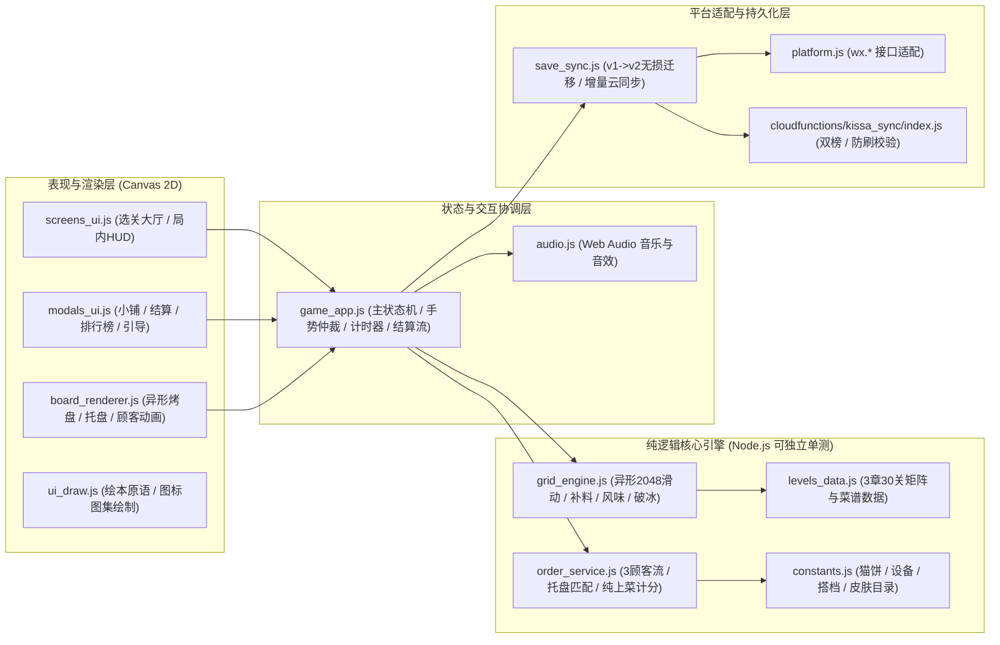

# 一起做猫饼 2.0 — 技术架构重构与代码改造方案

> **文档定位**：本文档面向微信小游戏前端与云开发后端研发人员，明确 `05-微信小游戏版本/` 与 `cloudfunctions/kissa_sync/` 的文件删改增矩阵、纯逻辑引擎数据结构与核心算法、v1→v2 存档无损迁移以及云函数重构规范。

---

## 1. 2.0 软件架构总览

2.0 彻底剥离重型 2D 刚体物理引擎（`physics.js`），将核心玩法抽离为**零平台依赖、可直接在 Node.js 下单测的纯数据引擎**（`grid_engine.js`、`order_service.js`、`levels_data.js`），与 Canvas 2D 渲染层（`board_renderer.js`、`screens_ui.js`）解耦。



---

## 2. 源码逐文件增删改矩阵

### 2.1 拟废弃与删除的文件（共 5 处）
| 文件路径 | 原用途 | 2.0 处理方式 |
| :--- | :--- | :--- |
| `05-微信小游戏版本/src/physics.js` | 2D 复合凸多边形 SAT/PGS 物理引擎 | **直接删除**（不再有重力掉落碰撞） |
| `05-微信小游戏版本/src/physics_shapes.js` | `tier_1~9` 物理凸多边形网格常量 | **直接删除** |
| `05-微信小游戏版本/src/jar_renderer.js` | 玻璃罐特写、发射器虚线、黄油弹柱绘制 | **直接删除**（由 `board_renderer.js` 替代） |
| `scripts/extract_physics_shapes.py` | 提取 Alpha 凸多边形轮廓脚本 | **直接删除**（无需物理碰撞多边形） |
| `02-游戏素材-精修透明PNG/physics_shapes.json` | 物理轮廓 JSON | **直接删除** |

### 2.2 拟新增的核心模块（`05-微信小游戏版本/src/` 下共 4 个新文件）
| 文件路径 | 核心职责 | 关键导出接口 |
| :--- | :--- | :--- |
| `src/grid_engine.js` | 异形盘格 2048 引擎（纯函数/无 DOM 依赖） | `createGridState(levelCfg, preplaced)`、`slideGrid(state, dir, spawnOpts)`、`kneadSpawn(state, spawnOpts)`、`removeTileAt(state, r, c)`、`upgradeTileAt(state, r, c)`、`shatterAdjacentIce(state, r, c)`、`canAnyMove(state)` |
| `src/order_service.js` | 顾客流、配餐托盘与**唯一计分模块** | `createOrderState(levelCfg, saveData)`、`stepCustomers(state, dt, freezeTimer)`、`tryPlaceToTray(state, tile)`、`discardTraySlot(state, slotIdx)`、`matchTrayToCustomer(state, preferredSeatIdx)`、`computeServeScore(order, usedTiles, ctx)` |
| `src/levels_data.js` | 3 大章节 30 关完整配置与 24 道菜谱表 | `CHAPTERS`、`RECIPES`、`LEVELS`（`1-1` 至 `3-10` 全部矩阵、时长、星级分与点单池）、`getLevelById(id)` |
| `src/board_renderer.js` | 局内异形烤盘、托盘、厨余篮、3 顾客与粒子渲染 | `renderCustomersBar(...)`、`renderTrayStrip(...)`、`renderBoardStage(...)`、`hitTestBoardCell(layout, lx, ly)` |

### 2.3 拟保留并改造的现有文件
| 文件路径 | 改造范围与说明 |
| :--- | :--- |
| `05-微信小游戏版本/game.js` | 入口保持不变（依然初始化 `game_app.js`） |
| `05-微信小游戏版本/project.config.json` | 可同步将 `projectname` 工程展示名称更新为 `一起做猫饼`（`appid` 保持不变） |
| `05-微信小游戏版本/src/platform.js` | 保留全部 `wx.*` 适配接口；微调 `setWxFriendCloudScore` 为上报总星数与累计高分；微信转发分享标题改为《一起做猫饼》 |
| `05-微信小游戏版本/src/cloud_config.js` | 保留云环境 ID 与 `CLOUD_FUNCTION_NAME = 'kissa_sync'`（保持原名确保云库无缝兼容），无结构变更 |
| `05-微信小游戏版本/src/constants.js` | 重构目录常量：写入 7 阶 `CATCAKES`、4 项 `SHOP_DEVICES`、8 位 `CUSTOMERS`、`PATRONS`（2.0 新技能数值）、`BOARD_THEMES`、`ASSET_PATHS`（更新为 `catcake_1~7`、`customers_atlas`、`board_tiles_atlas`）；删除旧 `SHIFTS`、`RELICS`、`DECK_MODS`、`SHIFT_HAZARDS`、`JAR` |
| `05-微信小游戏版本/src/audio.js` | 保留双音轨 BGM 引擎与现有复用音效；新增 `playGridSlide`、`playGridBlocked`、`playKneadSpawn`、`playTrayPlace`、`playTrayTrash`、`playCustomerAngry`、`playStarUnlock` 共 7 个合成音效 |
| `05-微信小游戏版本/src/ui_draw.js` | 保留绘本木牌/羊皮纸/FitText/Atlas 绘制工具；新增异形盘格斜纹木框与风味微标辅助函数 |
| `05-微信小游戏版本/src/game_app.js` | 重写主控制器（由 ~6000 行物理耦合瘦身为 ~2200 行清晰模块协调）：管理 `lobby / playing / result` 状态、手势仲裁（滑动 vs 单击装盘 vs 双击厨余）、实时营业计时器、搭档主动技、厨具使用与唯一上菜计分流 |
| `05-微信小游戏版本/src/screens_ui.js` | 大厅改为 3 章节选关路径地图（移除旧 3 模式卡），标题木牌主文字由 `星 夜 吃 茶` 改为 `一 起 做 猫 饼`；局内改造为顶栏星级条 + 3 顾客区 + 托盘带 + 烤盘舞台 + 补料与厨具/技能 Dock |
| `05-微信小游戏版本/src/modals_ui.js` | 重构「吃茶小铺」（猫饼菜价/后厨设备/搭档/烤盘皮肤4页签）、新增「关前整备简卡」与「1~3 星营业结算弹窗」、排行榜弹窗改双榜、更新图鉴与 2.0 玩法说明；移除旧 `renderPrepShopModal`、`renderRelicsModal`、`renderShiftVictoryModal`、`renderBlessingModal` |
| `05-微信小游戏版本/src/save_sync.js` | 升级存档结构为 `schemaVersion: 2`（保留 `STORAGE_KEY = 'hoshi_kissa_bakery_save_v1'` 以确保老玩家零丢档），编写无损迁移函数 `migrateV1ToV2` 与新版 `computeSpentStardust`；因单局只有 `90~150s` 且无物理残局，移除旧复杂 `savedRunsMap` 多模式断点快照（或仅保留未打烊选关进度的轻量校验） |
| `cloudfunctions/kissa_sync/index.js` | 升级云数据库校验与合并逻辑适配 `schemaVersion: 2`，将排行榜由 `bestChef/bestRush/bestZen` 重构为 `stars`（总星数进度榜）与 `totalScore`（全关卡高分和榜） |
| `scripts/extract_assets.py` | 保留去背核心算法，新增 `--v2` 参数支持合图 A/B/C/D 自动切片归一化并同步至 `05-微信小游戏版本/assets/` |
| `scripts/verify_minigame_e2e.mjs` | 保留 `window.wx` 无头 Chromium Harness，按 [06-测试与端到端验收规格书.md](./06-测试与端到端验收规格书.md) 重写 2.0 业务断言 |

---

## 3. 核心数据结构与算法设计

### 3.1 `grid_engine.js` — 异形 2048 数据结构与分段滑移算法

#### 单元格与猫饼实体结构
```js
// Cell 表示棋盘上的固定格属性
// type: 'normal' (.) | 'void' (#) | 'block' (X) | 'gold' (G) | 'matcha' (M) | 'berry' (B)
// tile: null | Tile
// Tile 结构:
{
  uid: 101,           // 全局递增唯一 ID，供动画追踪插值
  tier: 3,            // 1..7 (C1..C7)
  flavor: 'matcha',   // 'plain' | 'matcha' | 'berry' | 'gold'
  frozenHp: 0,        // 0 = 正常, 1 = 冰封不可动/不可直接合并/不可装盘
  fromR: 1,           // 动画起点行（用于 110ms 滑移插值）
  fromC: 2,
  justMerged: false,  // 本步新合成标记（触发 Q 弹放大）
  justSpawned: false  // 本步新刷出标记（触发面团弹出）
}
```

#### 异形分段滑动算法（`slideGrid(state, dir)`）
为保证任何异形缺角 `#`、木柱 `X` 和冰封块 `I` 都绝对准确截断滑道且绝不连合：
1. 根据方向 `dir`（`'left' | 'right' | 'up' | 'down'`）确定扫描的每条线（行或列）及前进向量。
2. 对每一条一维序列 `line`：
   - 按 `type === 'void' || type === 'block' || (cell.tile && cell.tile.frozenHp > 0)` 为**断点**，将 `line` 拆分成多个连续可滑动的**子段（Segment）**；
   - 对每个子段提取非空 `tile` 列表 `items`（按靠向滑动前沿的顺序排列）：
     - 指针 `i = 0` 遍历 `items`：
       - 若 `i + 1 < items.length` 且 `items[i].tier === items[i + 1].tier` 且 `items[i].tier < 7`：
         - 发生合并！生成 `newTier = items[i].tier + 1`；
         - 风味继承：`resolveMergedFlavor(movingTile, targetTile, destCellType)`；
         - 标记本步发生合成坐标 `(destR, destC)` 写入 `mergeEvents[]`，供随后统一触发上下左右 4 邻接破冰；
         - `i += 2`（**跳过下一颗，天然保证单步不连合**）；
       - 否则直接放置 `items[i]` 到当前空闲游标，并记录是否发生坐标位移，`i += 1`。
3. **有效判定与后续动作**：
   - 若没有任何 `tile` 位移且 `mergeEvents.length === 0`，返回 `{ moved: false }`（播放 `playGridBlocked`，**不刷新猫饼**）。
   - 若 `moved === true`：
     - 首先对 `mergeEvents` 中每个合成目标格 `(mr, mc)` 的上下左右 4 邻格检查 `frozenHp > 0`，若存在则置 `frozenHp = 0` 并推入 `brokenIceCells[]`（**注意：破冰发生在滑动定位之后，因此被震碎的冰块不会在本步顺带滑走**，避免视觉错乱）。
     - 其次对所有停留在 `G / M / B` 格上的非冰封 `tile` 应用格子染色（`gold` 优先级最高，不会降级为 `matcha/berry`）。
     - 最后调用 `spawnRandomLowTier(state, spawnOpts)` 在剩余空可用格中随机生成 1 颗 `C1` 或 `C2`（不计分）。

### 3.2 `order_service.js` — 配餐托盘多重集匹配与唯一计分

#### 顾客订单与托盘结构
```js
// 顾客座位席 (最多 3 席: seatIdx 0, 1, 2)
{
  uid: 21,
  seatIdx: 0,
  customerId: 'cust_silver', // 来自 constants.js CUSTOMERS
  isVip: false,
  isUrgent: false,           // cust_fox 急单
  recipeId: 'R16',
  recipeName: '抹茶猫神布丁',
  slots: [
    { tier: 4, flavor: 'matcha', matchedTrayIdx: -1 },
    { tier: 3, flavor: 'any',    matchedTrayIdx: -1 }
  ],
  patience: 28.0,            // 剩余秒数
  maxPatience: 28.0,
  rewardDustBonus: 0         // VIP 白猫为 5
}

// 配餐托盘: 固定长度数组 (3 或 4), null | { uid, tier, flavor }
```

#### 精准子集匹配算法（`matchCustomerWithTray(order, tray)`）
由于套餐可能出现同一阶数多份（如 `R06: C2 + C2`）或同时混有指定风味与不限风味（如 `C3[matcha] + C3[any]`），**必须采用“先精确匹配风味要求槽位，再匹配普通槽位，优先消耗非 `gold` 普通饼留着 `gold` 给更急需槽位”的贪心排序匹配**：
1. 复制当前非空托盘条目列表 `avail = tray.map((t, idx) => ({ idx, ...t })).filter(...)` 并记录已使用集合 `usedIndices = new Set()`。
2. 将订单槽位按**约束严格度降序排序**：先排 `flavor !== 'any'`（需指定风味），再排 `flavor === 'any'`。
3. 遍历排序后的订单槽位 `req`：
   - 若 `req.flavor !== 'any'`：优先找 `tier === req.tier && flavor === req.flavor` 的未使用托盘项；找不到再找 `tier === req.tier && flavor === 'gold'`（万能王牌）；
   - 若 `req.flavor === 'any'`：优先找 `tier === req.tier && flavor === 'plain'`；其次其他风味（`matcha`/`berry`）；最后才消耗 `gold`（尽量把万能且高价的 `gold` 省给真正缺风味或高倍率菜，如果托盘里只有 `gold` 同样匹配成功）。
   - 若任一槽位找不到匹配项，说明本顾客尚未凑齐（仅返回“托盘局部已备齐哪些槽位”用于 UI 打勾 `✓` 展示）。
4. **多顾客同时满足的出餐决策**：
   - 收集所有能被托盘完整匹配的在座顾客；
   - 按优先级排序：`手动锁定顾客(preferredSeatIdx)` > `剩余耐心百分比最低(patience / maxPatience)` > `VIP(isVip)` > `急单(isUrgent)`；
   - 选中唯一胜出顾客后，原子性地从 `tray` 中移除其所对应的 `usedIndices`，释放顾客座位，并调用唯一的 **`computeServeScore(...)`** 与 `addScore(pts)`！

### 3.3 `levels_data.js` — 关卡 JSON Schema 规范
```js
{
  id: '3-1',
  chapter: 3,
  indexInChapter: 1,
  name: '草莓雪夜',
  durationSec: 120,
  stars: [16500, 22800, 29000],
  baseClearDust: 18,
  firstStarDust: [25, 35, 45],
  matrix: [
    '.....',
    '.BI..',
    '..IM.',
    '#...#'
  ],
  presets: [
    { r: 0, c: 1, tier: 3, flavor: 'plain', frozen: false },
    { r: 0, c: 2, tier: 3, flavor: 'plain', frozen: false },
    { r: 1, c: 1, tier: 2, flavor: 'berry', frozen: false },
    { r: 1, c: 2, tier: 4, flavor: 'plain', frozen: true },
    { r: 2, c: 2, tier: 4, flavor: 'plain', frozen: true },
    { r: 2, c: 4, tier: 3, flavor: 'plain', frozen: false }
  ],
  allowedRecipes: ['R15','R16','R17','R18','R19','R20','R21','R22'],
  urgentRate: 0.25,
  vipQuota: 2
}
```

---

## 4. 存档 Schema v2 与无损迁移规范（`src/save_sync.js`）

沿用现行本地存储键名 `STORAGE_KEY = 'hoshi_kissa_bakery_save_v1'`，通过新增版本号字段 `schemaVersion: 2` 识别新旧存档，保证微信玩家无缝升级零丢档。

### 4.1 2.0 存档 JSON 结构
```jsonc
{
  "schemaVersion": 2,
  "bgmTrack": "waltz",
  "sfxEnabled": true,

  // 永久星尘银行与消费守恒字段
  "bankStardust": 180,
  "totalEarnedStardust": 300,
  "lastSyncedEarnedStardust": 300,

  // 30 关进度与星级（key 为关卡 ID '1-1'..'3-10'）
  "levelStars": { "1-1": 3, "1-2": 2 },
  "levelBestScores": { "1-1": 1520, "1-2": 1680 },
  "highestUnlockedLevel": "1-3",

  // 吃茶小铺 2.0 升级项
  "catcakeLevels": { "1": 1, "2": 1, "3": 0, "4": 0, "5": 0, "6": 0, "7": 0 },
  "deviceUpgrades": { "dev_tray": 1, "dev_flour": 0, "dev_teapot": 0, "dev_tools": 1 },

  // 搭档与主题皮肤（无缝保留老存档已解锁记录）
  "selectedPatron": "mikan",
  "unlockedPatrons": ["mikan", "luna"],
  "equippedTheme": "amber",
  "unlockedThemes": ["amber"],

  // 2.0 新手引导标记与生涯统计
  "seenTutorials": { "intro_slide": true, "tray_trash": false, "flavor_tile": false, "ice_tile": false },
  "playerProfile": { "nickName": "", "avatarUrl": "", "avatarPreset": "mikan", "authorized": false, "updatedAt": 0 },
  "lifetimeStats": {
    "runsPlayed": 12,
    "ordersServed": 94,
    "vipServed": 3,
    "maxComboEver": 6,
    "highestSingleServe": 1840,
    "totalStars": 5,
    "totalCumulativeScore": 3200
  },
  "updatedAt": 1795430000000
}
```

### 4.2 老存档 v1 → v2 无损迁移规则与防扣分坑点
当 `save_sync.js` 检测到 `parsed` 不含 `schemaVersion >= 2` 时，执行 `migrateV1ToV2(parsed)`：
1. **清理旧物理断点**：直接移除本地存储中的 `hoshi_kissa_active_run_v1` 与 `hoshi_kissa_active_runs_v2`，避免重启尝试恢复已删除的玻璃罐残局导致报错。
2. **保留身份与外观资产**：完整继承 `bgmTrack`、`sfxEnabled`、`playerProfile`、`selectedPatron`、`unlockedPatrons`、`equippedTheme`、`unlockedThemes` 与原有 `bankStardust`。
3. **旧天赋星尘 100% 退还（守恒公式防坑要点）**：
   - 旧版 `shopUpgrades`（`up_tools`、`up_fever`、`up_combo`、`up_dust`）已全部下线。
   - 由于 `save_sync.js` 与云函数通过 `bankStardust = totalEarnedStardust - computeSpentStardust(save)` 校验余额：只要 2.0 的 `computeSpentStardust` 不再扣除旧 `shopUpgrades` 的花费，老玩家花在旧天赋上的所有星尘就会**自动全额退还至 `bankStardust` 供重新升级猫饼与托盘**！
   - **关键差价补偿**：旧版 `luna` 解锁价为 `60 ⭐`、`mugi` 为 `100 ⭐`，而 2.0 新定价为 `luna = 80 ⭐`、`mugi = 120 ⭐`。迁移函数必须检测老玩家 `unlockedPatrons` 中每包含 `luna` 就使 `totalEarnedStardust += 20`、包含 `mugi` 就 `totalEarnedStardust += 20`，防止 `computeSpentStardust` 按新价扣除导致老玩家无端损失 `20~40 ⭐` 余额！
4. **老玩家感恩迎宾礼**：若旧存档 `bestChef > 0 || bestRush > 0 || bestZen > 0`，额外一次性赠送 `+50 ⭐` 过渡基金写入 `totalEarnedStardust`，并在迁移后首次进入大厅弹出温馨提示“已为您退还旧版厨房天赋星尘并附赠 50⭐ 老店长答谢礼”。

---

## 5. 微信云函数 `cloudfunctions/kissa_sync/index.js` 改造规范

1. **防刷校验矩阵更新**：
   - 将旧版 `UPGRADE_COSTS` 替换为 2.0 的 `CATCAKE_UPGRADE_COSTS`（1~7 阶各 4 级）与 `DEVICE_UPGRADE_COSTS`（`dev_tray`, `dev_flour`, `dev_teapot`, `dev_tools`），同步更新 `PATRON_COSTS`（`{ mikan: 0, luna: 80, mugi: 120 }`）与 `THEME_COSTS`（`{ amber: 0, sakura: 80, moonlight: 120 }`）。
   - 取消 `MAX_CHEF_SCORE / MAX_RUSH_SCORE / MAX_ZEN_SCORE` 三模式校验，改为校验 `levelStars` 每关 `0..3`（总星 `totalStars <= 90`）以及单关 `levelBestScores[id]` 合理上限（第 1 章 `<= 35,000`、第 2 章 `<= 90,000`、第 3 章 `<= 220,000`），并保留 `runReport` 的营业时长与上菜次数合理性反作弊（`serves >= 1` 才能产生得分）。
2. **老云端文档迁移兼容**：
   - 云函数 `pull` 或 `push` 遇到云端文档 `metaSave.schemaVersion !== 2` 时，在服务端执行与客户端完全同构的 `migrateV1ToV2`，确保多设备换机登录也不会退回旧数据或丢失星尘退款。
3. **排行榜双榜重构（`action === 'leaderboard'`）**：
   - 请求参数 `boardType: 'stars' | 'score'`（替代旧 `mode: 'chef'|'rush'|'zen'`）：
     - **`stars` 总星数进度榜**：按云文档顶层字段 `totalStars`（0~90）降序排序，同星数按 `totalCumulativeScore` 降序决胜；
     - **`score` 星夜累计营业榜**：按 `totalCumulativeScore`（所有 30 关最高分之和）降序排序。
   - 清除并停止写入 `savedRuns` / `activeRun` 物理断点大字段，显著降低云函数数据库读写带宽。

---

## 6. 分阶段研发实施顺序（依赖拓扑）

1. **Stage A（数据结构与纯引擎先行）**：完成 `constants.js`、`levels_data.js`、`grid_engine.js`、`order_service.js`，此时即可跑通全套 Node.js 逻辑单测，提前锁死数值与“纯上菜计分”铁律。
2. **Stage B（资源生产与替换）**：按 `04-美术与音频素材制作规范.md` 跑通 `extract_assets.py --v2` 生成新精灵与图集，同步删去旧 `physics*.js` 与 `tier_1~9` 资源。
3. **Stage C（渲染与控制器对接）**：编写 `board_renderer.js`、重构 `game_app.js` / `screens_ui.js` / `modals_ui.js`、增补 `audio.js` 7 个音效，实现选关地图→局内游玩→结算→小铺升级全闭环。
4. **Stage D（持久化与端到端回归）**：落地 `save_sync.js` v1→v2 迁移与 `kissa_sync` 云函数升级，最后完成 `verify_minigame_e2e.mjs` 全绿验收。
